# PhysiFun

## 説明

このディレクトリは `atlas/schema.sql` から tbls で自動生成している。**手で編集しない。**  
テーブル・列の説明は `schema.sql` の `COMMENT ON` に書き、`bun run db:docs` で再生成する（PR では CI が自動で再生成する）。  
まずは下の「領域別のビュー」から読むと全体を掴みやすい。設計の意図は docs/specs/03_data-model.md を参照。  
ズーム・検索ができる動く ER 図（Liam ERD）: https://physicalfunding.github.io/PhysiFun/  

## 領域別のビュー

| 名前                                                    | 説明                                                      |
| ------------------------------------------------------- | --------------------------------------------------------- |
| [アカウントと応募](viewpoint-account.md)                | 一般ユーザーのアカウントと、リーダー応募・運営による審査  |
| [プロジェクトと公開審査](viewpoint-project.md)          | プロジェクト本体と、運営による公開審査の履歴              |
| [サポート募集（未実装 #212）](viewpoint-recruitment.md) | スキーマだけ存在し、コードはまだ実装されていない          |
| [運営の認証と監査](viewpoint-admin.md)                  | 運営アカウントの Magic Link 認証・セッション・操作ログ    |
| [Outbox（非同期メール送信）](viewpoint-outbox.md)       | DB の更新と同じトランザクションで積む、送信待ちメッセージ |

## テーブル一覧

| 名前                                                                                      | カラム  | 説明                                                                                                                                                                                                                                                                            | 型         |
| ----------------------------------------------------------------------------------------- | ------- | ------------------------------------------------------------------------------------------------------------------------------------------------------------------------------------------------------------------------------------------------------------------------------- | ---------- |
| [public.admin_accounts](public.admin_accounts.md)                                         | 6       | 運営アカウント（apps/admin にログインする運営メンバー）。一般ユーザーの accounts とは別物。物理削除はせず status で無効化する。ドメインの AdminAccount 集約                                                                                                                     | BASE TABLE |
| [public.project_outbox_messages](public.project_outbox_messages.md)                       | 11      | プロジェクトの公開審査に関する送信待ちメール（Outbox）。状態の変更と同じトランザクションで積み、ワーカーが非同期で送る                                                                                                                                                          | BASE TABLE |
| [public.leader_application_outbox_messages](public.leader_application_outbox_messages.md) | 11      | リーダー応募に関する送信待ちメール（Outbox）。応募・審査と同じトランザクションで積み、ワーカーが非同期で送る                                                                                                                                                                    | BASE TABLE |
| [public.admin_verification_tokens](public.admin_verification_tokens.md)                   | 3       | 運営ログイン用 Magic Link のトークン（NextAuth の VerificationToken）。使うと削除され、期限切れのものも定期的に削除される。FK は持たない                                                                                                                                        | BASE TABLE |
| [public.admin_sessions](public.admin_sessions.md)                                         | 6       | 運営アプリのログインセッション（NextAuth の Database セッション）。有効期間は 1 時間で、使っている間は延長される。期限切れのものは定期的に削除される                                                                                                                            | BASE TABLE |
| [public.admin_audit_logs](public.admin_audit_logs.md)                                     | 8       | 運営の操作ログ（誰が・いつ・何に対して・何をしたか）。運営画面の操作ログ一覧で見る                                                                                                                                                                                              | BASE TABLE |
| [public.accounts](public.accounts.md)                                                     | 16      | 一般ユーザーのアカウント（サポーター・リーダー）。リーダー応募の送信時に作られ、メールのリンクからパスワードを設定すると有効になる                                                                                                                                              | BASE TABLE |
| [public.leader_applications](public.leader_applications.md)                               | 28      | リーダー応募（リーダーになるための申請）と運営の審査結果。応募内容は送信時点のスナップショットで、承認時に作られる projects とは参照でつながらない。ドメインの LeaderApplication 集約（project 系の列は ProjectDraft、連絡先・募集情報の列は LeaderApplicationSnapshot に載る） | BASE TABLE |
| [public.projects](public.projects.md)                                                     | 21      | リーダーが立ち上げるプロジェクト。公開審査（DRAFT → PENDING_REVIEW → PUBLISHED）を持つ。リーダー応募の承認時に、応募内容から下書きが作られる。ドメインの Project 集約                                                                                                           | BASE TABLE |
| [public.project_review_feedbacks](public.project_review_feedbacks.md)                     | 7       | プロジェクトの公開審査の履歴（承認・差戻・強制非公開）。差戻が繰り返されても全件残る。ドメインの ProjectReviewFeedback（Project のサブエンティティ）                                                                                                                            | BASE TABLE |
| [public.support_recruitments](public.support_recruitments.md)                             | 7       | 【未実装 #212】サポート募集。プロジェクトに紐づく募集の単位。スキーマだけ存在し、コードはまだ無い                                                                                                                                                                               | BASE TABLE |
| [public.recruitment_schedules](public.recruitment_schedules.md)                           | 9       | 【未実装 #212】サポート募集の日程。1 募集につき 1 日 1 行で、その日の受付時間帯と、1 時間ごとの定員を持つ                                                                                                                                                                       | BASE TABLE |
| [public.support_tickets](public.support_tickets.md)                                       | 9       | 【未実装 #212】サポートチケット。サポーターが日程の中の時間帯に参加を申し込んだ記録。チケットは提供する時間の単位を表す言葉で、購入や在庫は無い                                                                                                                                 | BASE TABLE |

## 列挙型

| 名前                                    | 値                                          |
| --------------------------------------- | ------------------------------------------- |
| public.AccountStatus                    | ACTIVE, PENDING_EMAIL_CONFIRMATION          |
| public.AdminAccountStatus               | ACTIVE, DISABLED                            |
| public.ApprovalMode                     | AUTO, MANUAL                                |
| public.LeaderApplicationRecruitmentType | SKILL_ITEM, TIME                            |
| public.LeaderApplicationStatus          | APPROVED, PENDING, REJECTED                 |
| public.ProjectPhase                     | EXECUTION, ONGOING, PLANNING, READY, VISION |
| public.PublishStatus                    | DRAFT, PENDING_REVIEW, PUBLISHED            |
| public.RecruitmentType                  | ACTIVITY                                    |
| public.ReviewAction                     | APPROVED, FORCE_UNPUBLISHED, REJECTED       |
| public.Role                             | LEADER, SUPPORTER                           |
| public.SupportTicketStatus              | CANCELLED, COMPLETED, CONFIRMED, PENDING    |

## ER 図

```mermaid
erDiagram

"public.admin_sessions" }o--|| "public.admin_accounts" : ""
"public.admin_audit_logs" }o--|| "public.admin_accounts" : ""
"public.admin_audit_logs" }o--o| "public.admin_sessions" : ""
"public.leader_applications" }o--o| "public.admin_accounts" : ""
"public.leader_applications" }o--|| "public.accounts" : ""
"public.projects" }o--o| "public.admin_accounts" : ""
"public.projects" }o--o| "public.admin_accounts" : ""
"public.projects" }o--|| "public.accounts" : ""
"public.project_review_feedbacks" }o--|| "public.admin_accounts" : ""
"public.project_review_feedbacks" }o--|| "public.projects" : ""
"public.support_recruitments" }o--|| "public.projects" : ""
"public.recruitment_schedules" }o--|| "public.support_recruitments" : ""
"public.support_tickets" }o--|| "public.accounts" : ""
"public.support_tickets" }o--|| "public.recruitment_schedules" : ""

"public.admin_accounts" {
  text id "運営アカウント ID（UUID v4。アプリ側で生成）"
}
"public.project_outbox_messages" {
}
"public.leader_application_outbox_messages" {
}
"public.admin_verification_tokens" {
}
"public.admin_sessions" {
  text id "セッション ID"
  text adminAccountId FK "ログインしている運営アカウント"
}
"public.admin_audit_logs" {
  text adminAccountId FK "操作した運営アカウント"
  text adminSessionId FK "操作したときのセッション。セッションが削除されると NULL になる"
}
"public.accounts" {
  text id "アカウント ID（UUID v4。アプリ側で生成）"
}
"public.leader_applications" {
  text accountId FK "応募者のアカウント"
  text reviewedBy FK "【未使用】審査した運営アカウント。どこからも書き込まれず常に NULL（審査の記録は admin_audit_logs に残る）"
}
"public.projects" {
  text id "プロジェクト ID（UUID v4。アプリ側で生成）"
  text ownerAccountId FK "所有者（リーダー）のアカウント"
  text forcedUnpublishedBy FK "【未使用】強制非公開にした運営アカウント。どこからも書き込まれず常に NULL（記録は project_review_feedbacks に残る）"
  text reviewedBy FK "【未使用】審査した運営アカウント。どこからも書き込まれず常に NULL（記録は project_review_feedbacks に残る）"
}
"public.project_review_feedbacks" {
  text projectId FK "審査したプロジェクト"
  text reviewerId FK "審査した運営アカウント"
}
"public.support_recruitments" {
  text id "サポート募集 ID"
  text projectId FK "募集を出したプロジェクト"
}
"public.recruitment_schedules" {
  text id "日程 ID"
  text supportRecruitmentId FK "日程が属するサポート募集"
}
"public.support_tickets" {
  text recruitmentScheduleId FK "申し込んだ日程"
  text supporterAccountId FK "申し込んだサポーターのアカウント"
}
```

---

> Generated by [tbls](https://github.com/k1LoW/tbls)
