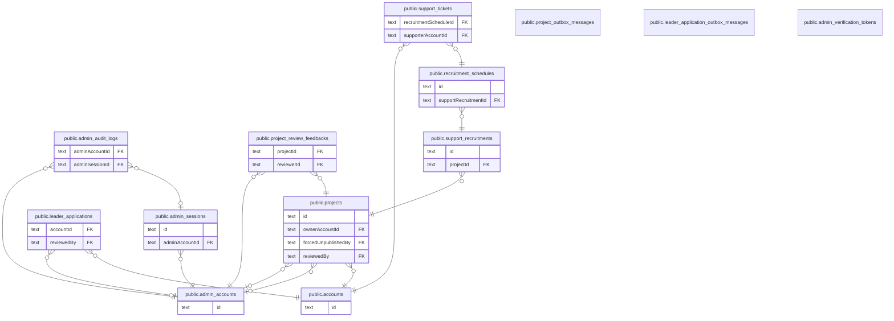

# PhysiFun

## 説明

このディレクトリは `atlas/schema.sql` から tbls で自動生成している。**手で編集しない。**  
テーブル・列の説明は `schema.sql` の `COMMENT ON` に書き、`bun run db:docs` で再生成する（PR では CI が自動で再生成する）。  
まずは下の「領域別のビュー」から読むと全体を掴みやすい。設計の意図は docs/specs/03_data-model.md を参照。  

## 領域別のビュー

| 名前                                                    | 説明                                                      |
| ------------------------------------------------------- | --------------------------------------------------------- |
| [アカウントと応募](viewpoint-account.md)                | 一般ユーザーのアカウントと、リーダー応募・運営による審査  |
| [プロジェクトと公開審査](viewpoint-project.md)          | プロジェクト本体と、運営による公開審査の履歴              |
| [サポート募集（未実装 #212）](viewpoint-recruitment.md) | スキーマだけ存在し、コードはまだ実装されていない          |
| [運営の認証と監査](viewpoint-admin.md)                  | 運営アカウントの Magic Link 認証・セッション・操作ログ    |
| [Outbox（非同期メール送信）](viewpoint-outbox.md)       | DB の更新と同じトランザクションで積む、送信待ちメッセージ |

## テーブル一覧

| 名前                                                                                      | カラム  | 説明    | 型         |
| ----------------------------------------------------------------------------------------- | ------- | ------- | ---------- |
| [public.admin_accounts](public.admin_accounts.md)                                         | 6       |         | BASE TABLE |
| [public.project_outbox_messages](public.project_outbox_messages.md)                       | 11      |         | BASE TABLE |
| [public.leader_application_outbox_messages](public.leader_application_outbox_messages.md) | 11      |         | BASE TABLE |
| [public.admin_verification_tokens](public.admin_verification_tokens.md)                   | 3       |         | BASE TABLE |
| [public.admin_sessions](public.admin_sessions.md)                                         | 6       |         | BASE TABLE |
| [public.admin_audit_logs](public.admin_audit_logs.md)                                     | 8       |         | BASE TABLE |
| [public.accounts](public.accounts.md)                                                     | 16      |         | BASE TABLE |
| [public.leader_applications](public.leader_applications.md)                               | 28      |         | BASE TABLE |
| [public.projects](public.projects.md)                                                     | 21      |         | BASE TABLE |
| [public.project_review_feedbacks](public.project_review_feedbacks.md)                     | 7       |         | BASE TABLE |
| [public.support_recruitments](public.support_recruitments.md)                             | 7       |         | BASE TABLE |
| [public.recruitment_schedules](public.recruitment_schedules.md)                           | 9       |         | BASE TABLE |
| [public.support_tickets](public.support_tickets.md)                                       | 9       |         | BASE TABLE |

## 列挙型

| 名前                                    | 値                                          |
| --------------------------------------- | ------------------------------------------- |
| public.AccountStatus                    | ACTIVE, PENDING_EMAIL_CONFIRMATION          |
| public.AdminAccountStatus               | ACTIVE, DISABLED                            |
| public.ApprovalMode                     | AUTO, MANUAL                                |
| public.LeaderApplicationRecruitmentType | SKILL_ITEM, TIME                            |
| public.LeaderApplicationStatus          | APPROVED, PENDING, REJECTED                 |
| public.ProjectPhase                     | EXECUTION, ONGOING, PLANNING, READY, VISION |
| public.PublishStatus                    | DRAFT, PENDING_REVIEW, PUBLISHED            |
| public.RecruitmentType                  | ACTIVITY                                    |
| public.ReviewAction                     | APPROVED, FORCE_UNPUBLISHED, REJECTED       |
| public.Role                             | LEADER, SUPPORTER                           |
| public.SupportTicketStatus              | CANCELLED, COMPLETED, CONFIRMED, PENDING    |

## ER 図

---

> Generated by [tbls](https://github.com/k1LoW/tbls)
