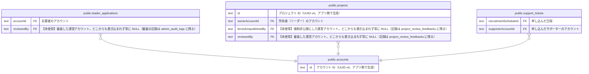

# public.accounts

## 説明

一般ユーザーのアカウント（サポーター・リーダー）。リーダー応募の送信時に作られ、メールのリンクからパスワードを設定すると有効になる

## カラム

| 名前               | 型                             | 既定値            | NULL 可 | 参照元                                                                                                                                                | 説明                                                                                                |
| ------------------ | ------------------------------ | ----------------- | ------- | ----------------------------------------------------------------------------------------------------------------------------------------------------- | --------------------------------------------------------------------------------------------------- |
| id                 | text                           |                   | false   | [public.leader_applications](public.leader_applications.md) [public.projects](public.projects.md) [public.support_tickets](public.support_tickets.md) | アカウント ID（UUID v4。アプリ側で生成）                                                            |
| email              | text                           |                   | false   |                                                                                                                                                       | ログイン ID のメールアドレス（小文字・前後の空白なしに正規化）                                      |
| displayName        | text                           |                   | false   |                                                                                                                                                       | 表示名（1〜50 文字）                                                                                |
| status             | "AccountStatus"                |                   | false   |                                                                                                                                                       | PENDING_EMAIL_CONFIRMATION=メール確認待ち（作成から 72 時間で自動削除）/ ACTIVE=有効                |
| passwordHash       | text                           |                   | true    |                                                                                                                                                       | パスワードの bcrypt ハッシュ。アクティベーション前は NULL                                           |
| roles              | "Role"[]                       |                   | true    |                                                                                                                                                       | ロール（SUPPORTER / LEADER。複数可）。作成時は SUPPORTER で、リーダー応募の承認で LEADER が加わる   |
| activationToken    | text                           |                   | true    |                                                                                                                                                       | アクティベーション URL に含めるトークン（ランダムな 64 桁の 16 進数）。有効化すると NULL            |
| activationTokenExp | timestamp(3) without time zone |                   | true    |                                                                                                                                                       | activationToken の有効期限（発行から 24 時間）。有効化すると NULL                                   |
| iconUrl            | text                           |                   | true    |                                                                                                                                                       | 【未使用】アイコン画像の URL。設定する機能が無い                                                    |
| bio                | text                           |                   | true    |                                                                                                                                                       | 自己紹介。公開ページと運営画面で表示するが、設定する機能が無く現状は常に NULL                       |
| snsLinks           | jsonb                          |                   | true    |                                                                                                                                                       | 【未使用】SNS リンク。現状は応募（leader_applications）とプロジェクト（projects）の snsLinks を使う |
| contributedHours   | integer                        | 0                 | false   |                                                                                                                                                       | 【未使用】提供時間の累計（時間）。サポーターとして他のプロジェクトに提供した時間                    |
| receivedHours      | integer                        | 0                 | false   |                                                                                                                                                       | 【未使用】参加時間の累計（時間）。リーダーとして自分のプロジェクトでサポーターから受けた時間        |
| createdAt          | timestamp(3) without time zone | CURRENT_TIMESTAMP | false   |                                                                                                                                                       | 作成日時                                                                                            |
| updatedAt          | timestamp(3) without time zone |                   | false   |                                                                                                                                                       | 更新日時（アプリ側で設定する）                                                                      |
| phoneNumber        | text                           |                   | true    |                                                                                                                                                       | 電話番号（任意。最大 20 文字、ハイフン可）。リーダー応募のときに入力された値                        |

## 領域別のビュー

| 名前                                                    | 定義                                                     |
| ------------------------------------------------------- | -------------------------------------------------------- |
| [アカウントと応募](viewpoint-account.md)                | 一般ユーザーのアカウントと、リーダー応募・運営による審査 |
| [プロジェクトと公開審査](viewpoint-project.md)          | プロジェクト本体と、運営による公開審査の履歴             |
| [サポート募集（未実装 #212）](viewpoint-recruitment.md) | スキーマだけ存在し、コードはまだ実装されていない         |

## 制約

| 名前          | 型          | 定義             |
| ------------- | ----------- | ---------------- |
| accounts_pkey | PRIMARY KEY | PRIMARY KEY (id) |

## インデックス

| 名前                         | 定義                                                                                                  |
| ---------------------------- | ----------------------------------------------------------------------------------------------------- |
| accounts_pkey                | CREATE UNIQUE INDEX accounts_pkey ON public.accounts USING btree (id)                                 |
| accounts_activationToken_key | CREATE UNIQUE INDEX "accounts_activationToken_key" ON public.accounts USING btree ("activationToken") |
| accounts_email_key           | CREATE UNIQUE INDEX accounts_email_key ON public.accounts USING btree (email)                         |
| accounts_status_idx          | CREATE INDEX accounts_status_idx ON public.accounts USING btree (status)                              |

## ER 図

---

> Generated by [tbls](https://github.com/k1LoW/tbls)
