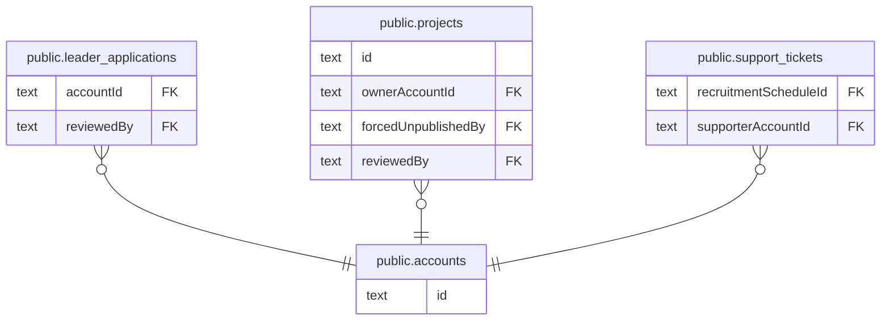

# public.accounts

## カラム

| 名前               | 型                             | 既定値            | NULL 可 | 参照元                                                                                                                                                | 説明 |
| ------------------ | ------------------------------ | ----------------- | ------- | ----------------------------------------------------------------------------------------------------------------------------------------------------- | ---- |
| id                 | text                           |                   | false   | [public.leader_applications](public.leader_applications.md) [public.projects](public.projects.md) [public.support_tickets](public.support_tickets.md) |      |
| email              | text                           |                   | false   |                                                                                                                                                       |      |
| displayName        | text                           |                   | false   |                                                                                                                                                       |      |
| status             | "AccountStatus"                |                   | false   |                                                                                                                                                       |      |
| passwordHash       | text                           |                   | true    |                                                                                                                                                       |      |
| roles              | "Role"[]                       |                   | true    |                                                                                                                                                       |      |
| activationToken    | text                           |                   | true    |                                                                                                                                                       |      |
| activationTokenExp | timestamp(3) without time zone |                   | true    |                                                                                                                                                       |      |
| iconUrl            | text                           |                   | true    |                                                                                                                                                       |      |
| bio                | text                           |                   | true    |                                                                                                                                                       |      |
| snsLinks           | jsonb                          |                   | true    |                                                                                                                                                       |      |
| contributedHours   | integer                        | 0                 | false   |                                                                                                                                                       |      |
| receivedHours      | integer                        | 0                 | false   |                                                                                                                                                       |      |
| createdAt          | timestamp(3) without time zone | CURRENT_TIMESTAMP | false   |                                                                                                                                                       |      |
| updatedAt          | timestamp(3) without time zone |                   | false   |                                                                                                                                                       |      |
| phoneNumber        | text                           |                   | true    |                                                                                                                                                       |      |

## 領域別のビュー

| 名前                                                    | 定義                                                     |
| ------------------------------------------------------- | -------------------------------------------------------- |
| [アカウントと応募](viewpoint-account.md)                | 一般ユーザーのアカウントと、リーダー応募・運営による審査 |
| [プロジェクトと公開審査](viewpoint-project.md)          | プロジェクト本体と、運営による公開審査の履歴             |
| [サポート募集（未実装 #212）](viewpoint-recruitment.md) | スキーマだけ存在し、コードはまだ実装されていない         |

## 制約

| 名前          | 型          | 定義             |
| ------------- | ----------- | ---------------- |
| accounts_pkey | PRIMARY KEY | PRIMARY KEY (id) |

## インデックス

| 名前                         | 定義                                                                                                  |
| ---------------------------- | ----------------------------------------------------------------------------------------------------- |
| accounts_pkey                | CREATE UNIQUE INDEX accounts_pkey ON public.accounts USING btree (id)                                 |
| accounts_activationToken_key | CREATE UNIQUE INDEX "accounts_activationToken_key" ON public.accounts USING btree ("activationToken") |
| accounts_email_key           | CREATE UNIQUE INDEX accounts_email_key ON public.accounts USING btree (email)                         |
| accounts_status_idx          | CREATE INDEX accounts_status_idx ON public.accounts USING btree (status)                              |

## ER 図

---

> Generated by [tbls](https://github.com/k1LoW/tbls)
