# public.admin_accounts

## 説明

運営アカウント（apps/admin にログインする運営メンバー）。一般ユーザーの accounts とは別物。物理削除はせず status で無効化する。ドメインの AdminAccount 集約

## カラム

| 名前        | 型                             | 既定値                         | NULL 可 | 参照元                                                                                                                                                                                                                                                                          | 説明                                                                                                      |
| ----------- | ------------------------------ | ------------------------------ | ------- | ------------------------------------------------------------------------------------------------------------------------------------------------------------------------------------------------------------------------------------------------------------------------------- | --------------------------------------------------------------------------------------------------------- |
| id          | text                           |                                | false   | [public.admin_sessions](public.admin_sessions.md) [public.admin_audit_logs](public.admin_audit_logs.md) [public.leader_applications](public.leader_applications.md) [public.projects](public.projects.md) [public.project_review_feedbacks](public.project_review_feedbacks.md) | 運営アカウント ID（UUID v4。アプリ側で生成）                                                              |
| email       | text                           |                                | false   |                                                                                                                                                                                                                                                                                 | ログインに使うメールアドレス（小文字・前後の空白なしに正規化。最大 254 文字）                             |
| status      | "AdminAccountStatus"           | 'ACTIVE'::"AdminAccountStatus" | false   |                                                                                                                                                                                                                                                                                 | ACTIVE=ログインできる / DISABLED=無効化済み（退職時など。自分自身は無効化できない）                       |
| lastLoginAt | timestamp(3) without time zone |                                | true    |                                                                                                                                                                                                                                                                                 | 最後にログインした日時。【注意】記録する処理（AdminAccount.recordLogin）が呼ばれておらず、現状は常に NULL |
| createdAt   | timestamp(3) without time zone | CURRENT_TIMESTAMP              | false   |                                                                                                                                                                                                                                                                                 | 作成日時                                                                                                  |
| updatedAt   | timestamp(3) without time zone |                                | false   |                                                                                                                                                                                                                                                                                 | 更新日時（アプリ側で設定する）                                                                            |

## 領域別のビュー

| 名前                                           | 定義                                                     |
| ---------------------------------------------- | -------------------------------------------------------- |
| [アカウントと応募](viewpoint-account.md)       | 一般ユーザーのアカウントと、リーダー応募・運営による審査 |
| [プロジェクトと公開審査](viewpoint-project.md) | プロジェクト本体と、運営による公開審査の履歴             |
| [運営の認証と監査](viewpoint-admin.md)         | 運営アカウントの Magic Link 認証・セッション・操作ログ   |

## 制約

| 名前                | 型          | 定義             |
| ------------------- | ----------- | ---------------- |
| admin_accounts_pkey | PRIMARY KEY | PRIMARY KEY (id) |

## インデックス

| 名前                      | 定義                                                                                      |
| ------------------------- | ----------------------------------------------------------------------------------------- |
| admin_accounts_pkey       | CREATE UNIQUE INDEX admin_accounts_pkey ON public.admin_accounts USING btree (id)         |
| admin_accounts_email_key  | CREATE UNIQUE INDEX admin_accounts_email_key ON public.admin_accounts USING btree (email) |
| admin_accounts_status_idx | CREATE INDEX admin_accounts_status_idx ON public.admin_accounts USING btree (status)      |

## ER 図

```mermaid
erDiagram

"public.admin_sessions" }o--|| "public.admin_accounts" : ""
"public.admin_audit_logs" }o--|| "public.admin_accounts" : ""
"public.leader_applications" }o--o| "public.admin_accounts" : ""
"public.projects" }o--o| "public.admin_accounts" : ""
"public.projects" }o--o| "public.admin_accounts" : ""
"public.project_review_feedbacks" }o--|| "public.admin_accounts" : ""

"public.admin_accounts" {
  text id "運営アカウント ID（UUID v4。アプリ側で生成）"
}
"public.admin_sessions" {
  text id "セッション ID"
  text adminAccountId FK "ログインしている運営アカウント"
}
"public.admin_audit_logs" {
  text adminAccountId FK "操作した運営アカウント"
  text adminSessionId FK "操作したときのセッション。セッションが削除されると NULL になる"
}
"public.leader_applications" {
  text accountId FK "応募者のアカウント"
  text reviewedBy FK "【未使用】審査した運営アカウント。どこからも書き込まれず常に NULL（審査の記録は admin_audit_logs に残る）"
}
"public.projects" {
  text id "プロジェクト ID（UUID v4。アプリ側で生成）"
  text ownerAccountId FK "所有者（リーダー）のアカウント"
  text forcedUnpublishedBy FK "【未使用】強制非公開にした運営アカウント。どこからも書き込まれず常に NULL（記録は project_review_feedbacks に残る）"
  text reviewedBy FK "【未使用】審査した運営アカウント。どこからも書き込まれず常に NULL（記録は project_review_feedbacks に残る）"
}
"public.project_review_feedbacks" {
  text projectId FK "審査したプロジェクト"
  text reviewerId FK "審査した運営アカウント"
}
```

---

> Generated by [tbls](https://github.com/k1LoW/tbls)
