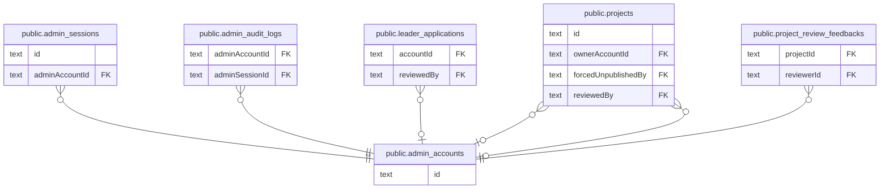

# public.admin_accounts

## カラム

| 名前        | 型                             | 既定値                         | NULL 可 | 参照元                                                                                                                                                                                                                                                                          | 説明 |
| ----------- | ------------------------------ | ------------------------------ | ------- | ------------------------------------------------------------------------------------------------------------------------------------------------------------------------------------------------------------------------------------------------------------------------------- | ---- |
| id          | text                           |                                | false   | [public.admin_sessions](public.admin_sessions.md) [public.admin_audit_logs](public.admin_audit_logs.md) [public.leader_applications](public.leader_applications.md) [public.projects](public.projects.md) [public.project_review_feedbacks](public.project_review_feedbacks.md) |      |
| email       | text                           |                                | false   |                                                                                                                                                                                                                                                                                 |      |
| status      | "AdminAccountStatus"           | 'ACTIVE'::"AdminAccountStatus" | false   |                                                                                                                                                                                                                                                                                 |      |
| lastLoginAt | timestamp(3) without time zone |                                | true    |                                                                                                                                                                                                                                                                                 |      |
| createdAt   | timestamp(3) without time zone | CURRENT_TIMESTAMP              | false   |                                                                                                                                                                                                                                                                                 |      |
| updatedAt   | timestamp(3) without time zone |                                | false   |                                                                                                                                                                                                                                                                                 |      |

## 領域別のビュー

| 名前                                           | 定義                                                     |
| ---------------------------------------------- | -------------------------------------------------------- |
| [アカウントと応募](viewpoint-account.md)       | 一般ユーザーのアカウントと、リーダー応募・運営による審査 |
| [プロジェクトと公開審査](viewpoint-project.md) | プロジェクト本体と、運営による公開審査の履歴             |
| [運営の認証と監査](viewpoint-admin.md)         | 運営アカウントの Magic Link 認証・セッション・操作ログ   |

## 制約

| 名前                | 型          | 定義             |
| ------------------- | ----------- | ---------------- |
| admin_accounts_pkey | PRIMARY KEY | PRIMARY KEY (id) |

## インデックス

| 名前                      | 定義                                                                                      |
| ------------------------- | ----------------------------------------------------------------------------------------- |
| admin_accounts_pkey       | CREATE UNIQUE INDEX admin_accounts_pkey ON public.admin_accounts USING btree (id)         |
| admin_accounts_email_key  | CREATE UNIQUE INDEX admin_accounts_email_key ON public.admin_accounts USING btree (email) |
| admin_accounts_status_idx | CREATE INDEX admin_accounts_status_idx ON public.admin_accounts USING btree (status)      |

## ER 図

---

> Generated by [tbls](https://github.com/k1LoW/tbls)
