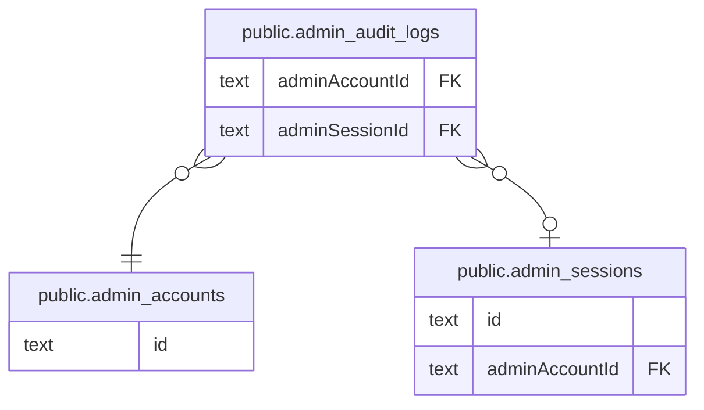

# public.admin_audit_logs

## カラム

| 名前           | 型                             | 既定値            | NULL 可 | 参照先                                            | 説明 |
| -------------- | ------------------------------ | ----------------- | ------- | ------------------------------------------------- | ---- |
| id             | text                           |                   | false   |                                                   |      |
| adminAccountId | text                           |                   | false   | [public.admin_accounts](public.admin_accounts.md) |      |
| adminSessionId | text                           |                   | true    | [public.admin_sessions](public.admin_sessions.md) |      |
| action         | text                           |                   | false   |                                                   |      |
| targetType     | text                           |                   | false   |                                                   |      |
| targetId       | text                           |                   | true    |                                                   |      |
| metadata       | jsonb                          |                   | true    |                                                   |      |
| createdAt      | timestamp(3) without time zone | CURRENT_TIMESTAMP | false   |                                                   |      |

## 領域別のビュー

| 名前                                   | 定義                                                   |
| -------------------------------------- | ------------------------------------------------------ |
| [運営の認証と監査](viewpoint-admin.md) | 運営アカウントの Magic Link 認証・セッション・操作ログ |

## 制約

| 名前                                 | 型          | 定義                                                                                              |
| ------------------------------------ | ----------- | ------------------------------------------------------------------------------------------------- |
| admin_audit_logs_adminAccountId_fkey | FOREIGN KEY | FOREIGN KEY ("adminAccountId") REFERENCES admin_accounts(id) ON UPDATE CASCADE ON DELETE RESTRICT |
| admin_audit_logs_adminSessionId_fkey | FOREIGN KEY | FOREIGN KEY ("adminSessionId") REFERENCES admin_sessions(id) ON UPDATE CASCADE ON DELETE SET NULL |
| admin_audit_logs_pkey                | PRIMARY KEY | PRIMARY KEY (id)                                                                                  |

## インデックス

| 名前                                          | 定義                                                                                                                                |
| --------------------------------------------- | ----------------------------------------------------------------------------------------------------------------------------------- |
| admin_audit_logs_pkey                         | CREATE UNIQUE INDEX admin_audit_logs_pkey ON public.admin_audit_logs USING btree (id)                                               |
| admin_audit_logs_action_createdAt_idx         | CREATE INDEX "admin_audit_logs_action_createdAt_idx" ON public.admin_audit_logs USING btree (action, "createdAt")                   |
| admin_audit_logs_adminAccountId_createdAt_idx | CREATE INDEX "admin_audit_logs_adminAccountId_createdAt_idx" ON public.admin_audit_logs USING btree ("adminAccountId", "createdAt") |
| admin_audit_logs_adminSessionId_idx           | CREATE INDEX "admin_audit_logs_adminSessionId_idx" ON public.admin_audit_logs USING btree ("adminSessionId")                        |
| admin_audit_logs_createdAt_idx                | CREATE INDEX "admin_audit_logs_createdAt_idx" ON public.admin_audit_logs USING btree ("createdAt")                                  |
| admin_audit_logs_targetType_createdAt_idx     | CREATE INDEX "admin_audit_logs_targetType_createdAt_idx" ON public.admin_audit_logs USING btree ("targetType", "createdAt")         |
| admin_audit_logs_targetType_targetId_idx      | CREATE INDEX "admin_audit_logs_targetType_targetId_idx" ON public.admin_audit_logs USING btree ("targetType", "targetId")           |

## ER 図

---

> Generated by [tbls](https://github.com/k1LoW/tbls)
