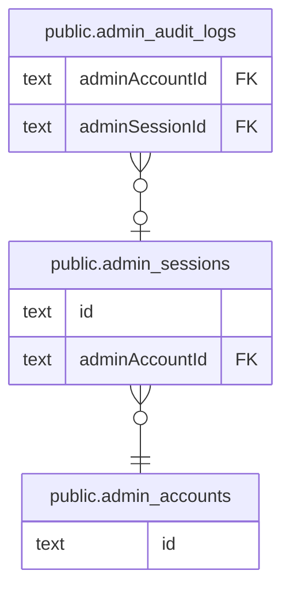

# public.admin_sessions

## カラム

| 名前           | 型                             | 既定値            | NULL 可 | 参照元                                                | 参照先                                            | 説明 |
| -------------- | ------------------------------ | ----------------- | ------- | ----------------------------------------------------- | ------------------------------------------------- | ---- |
| id             | text                           |                   | false   | [public.admin_audit_logs](public.admin_audit_logs.md) |                                                   |      |
| sessionToken   | text                           |                   | false   |                                                       |                                                   |      |
| adminAccountId | text                           |                   | false   |                                                       | [public.admin_accounts](public.admin_accounts.md) |      |
| expires        | timestamp(3) without time zone |                   | false   |                                                       |                                                   |      |
| createdAt      | timestamp(3) without time zone | CURRENT_TIMESTAMP | false   |                                                       |                                                   |      |
| updatedAt      | timestamp(3) without time zone |                   | false   |                                                       |                                                   |      |

## 領域別のビュー

| 名前                                   | 定義                                                   |
| -------------------------------------- | ------------------------------------------------------ |
| [運営の認証と監査](viewpoint-admin.md) | 運営アカウントの Magic Link 認証・セッション・操作ログ |

## 制約

| 名前                               | 型          | 定義                                                                                             |
| ---------------------------------- | ----------- | ------------------------------------------------------------------------------------------------ |
| admin_sessions_adminAccountId_fkey | FOREIGN KEY | FOREIGN KEY ("adminAccountId") REFERENCES admin_accounts(id) ON UPDATE CASCADE ON DELETE CASCADE |
| admin_sessions_pkey                | PRIMARY KEY | PRIMARY KEY (id)                                                                                 |

## インデックス

| 名前                              | 定義                                                                                                        |
| --------------------------------- | ----------------------------------------------------------------------------------------------------------- |
| admin_sessions_pkey               | CREATE UNIQUE INDEX admin_sessions_pkey ON public.admin_sessions USING btree (id)                           |
| admin_sessions_adminAccountId_idx | CREATE INDEX "admin_sessions_adminAccountId_idx" ON public.admin_sessions USING btree ("adminAccountId")    |
| admin_sessions_expires_idx        | CREATE INDEX admin_sessions_expires_idx ON public.admin_sessions USING btree (expires)                      |
| admin_sessions_sessionToken_key   | CREATE UNIQUE INDEX "admin_sessions_sessionToken_key" ON public.admin_sessions USING btree ("sessionToken") |

## ER 図

---

> Generated by [tbls](https://github.com/k1LoW/tbls)
