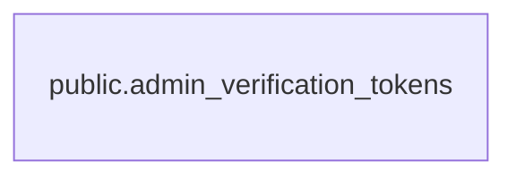

# public.admin_verification_tokens

## カラム

| 名前       | 型                             | 既定値 | NULL 可 | 説明 |
| ---------- | ------------------------------ | ------ | ------- | ---- |
| identifier | text                           |        | false   |      |
| token      | text                           |        | false   |      |
| expires    | timestamp(3) without time zone |        | false   |      |

## 領域別のビュー

| 名前                                   | 定義                                                   |
| -------------------------------------- | ------------------------------------------------------ |
| [運営の認証と監査](viewpoint-admin.md) | 運営アカウントの Magic Link 認証・セッション・操作ログ |

## インデックス

| 名前                                           | 定義                                                                                                                                   |
| ---------------------------------------------- | -------------------------------------------------------------------------------------------------------------------------------------- |
| admin_verification_tokens_expires_idx          | CREATE INDEX admin_verification_tokens_expires_idx ON public.admin_verification_tokens USING btree (expires)                           |
| admin_verification_tokens_identifier_token_key | CREATE UNIQUE INDEX admin_verification_tokens_identifier_token_key ON public.admin_verification_tokens USING btree (identifier, token) |
| admin_verification_tokens_token_key            | CREATE UNIQUE INDEX admin_verification_tokens_token_key ON public.admin_verification_tokens USING btree (token)                        |

## ER 図

---

> Generated by [tbls](https://github.com/k1LoW/tbls)
