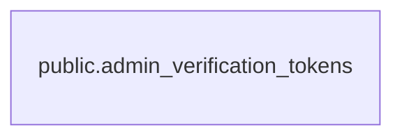

# public.admin_verification_tokens

## 説明

運営ログイン用 Magic Link のトークン（NextAuth の VerificationToken）。使うと削除され、期限切れのものも定期的に削除される。FK は持たない

## カラム

| 名前       | 型                             | 既定値 | NULL 可 | 説明                                                                               |
| ---------- | ------------------------------ | ------ | ------- | ---------------------------------------------------------------------------------- |
| identifier | text                           |        | false   | Magic Link の送信先メールアドレス（小文字・前後の空白なしに正規化）                |
| token      | text                           |        | false   | Magic Link に含まれるトークンのハッシュ値（NextAuth がハッシュ化してから保存する） |
| expires    | timestamp(3) without time zone |        | false   | 有効期限（発行から 10 分）                                                         |

## 領域別のビュー

| 名前                                   | 定義                                                   |
| -------------------------------------- | ------------------------------------------------------ |
| [運営の認証と監査](viewpoint-admin.md) | 運営アカウントの Magic Link 認証・セッション・操作ログ |

## インデックス

| 名前                                           | 定義                                                                                                                                   |
| ---------------------------------------------- | -------------------------------------------------------------------------------------------------------------------------------------- |
| admin_verification_tokens_expires_idx          | CREATE INDEX admin_verification_tokens_expires_idx ON public.admin_verification_tokens USING btree (expires)                           |
| admin_verification_tokens_identifier_token_key | CREATE UNIQUE INDEX admin_verification_tokens_identifier_token_key ON public.admin_verification_tokens USING btree (identifier, token) |
| admin_verification_tokens_token_key            | CREATE UNIQUE INDEX admin_verification_tokens_token_key ON public.admin_verification_tokens USING btree (token)                        |

## ER 図

---

> Generated by [tbls](https://github.com/k1LoW/tbls)
