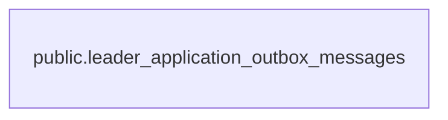

# public.leader_application_outbox_messages

## 説明

リーダー応募に関する送信待ちメール（Outbox）。応募・審査と同じトランザクションで積み、ワーカーが非同期で送る

## カラム

| 名前           | 型                             | 既定値            | NULL 可 | 説明                                                                                                                                        |
| -------------- | ------------------------------ | ----------------- | ------- | ------------------------------------------------------------------------------------------------------------------------------------------- |
| id             | text                           |                   | false   | メッセージ ID（UUID v4。アプリ側で生成）                                                                                                    |
| type           | text                           |                   | false   | メッセージの種類（ACTIVATION_EMAIL=アクティベーションメール / approved.notify_applicant=承認の通知 / rejected.notify_applicant=却下の通知） |
| payload        | jsonb                          |                   | false   | 送信に必要なデータ（JSON。形はメッセージの種類ごとに違う）                                                                                  |
| createdAt      | timestamp(3) without time zone | CURRENT_TIMESTAMP | false   | 積んだ日時。古いものから順に処理する                                                                                                        |
| sentAt         | timestamp(3) without time zone |                   | true    | 送信が完了した日時。運営画面で完了扱いにした場合も入る。未送信は NULL                                                                       |
| attempts       | integer                        | 0                 | false   | 送信を試みた回数。失敗のたびに増え、運営画面の手動リトライでも戻さない                                                                      |
| lastError      | text                           |                   | true    | 最後に失敗したときのエラー内容。手動リトライで NULL に戻る                                                                                  |
| nextRetryAt    | timestamp(3) without time zone |                   | true    | 次に再送してよい日時（失敗後に指数バックオフで設定）。NULL ならすぐ処理対象                                                                 |
| deadLetteredAt | timestamp(3) without time zone |                   | true    | 最大試行回数（既定 10 回）を超えて再送をやめた日時。運営画面の手動リトライで NULL に戻る                                                    |
| claimedAt      | timestamp(3) without time zone |                   | true    | ワーカーが処理のために確保した日時。5 分を過ぎた確保は無効とみなし、別のワーカーが取り直せる                                                |
| claimedBy      | text                           |                   | true    | 確保したワーカーの実行ごとの ID（ランダムな UUID）。処理が終わると NULL                                                                     |

## 領域別のビュー

| 名前                                              | 定義                                                      |
| ------------------------------------------------- | --------------------------------------------------------- |
| [Outbox（非同期メール送信）](viewpoint-outbox.md) | DB の更新と同じトランザクションで積む、送信待ちメッセージ |

## 制約

| 名前                                    | 型          | 定義             |
| --------------------------------------- | ----------- | ---------------- |
| leader_application_outbox_messages_pkey | PRIMARY KEY | PRIMARY KEY (id) |

## インデックス

| 名前                                                            | 定義                                                                                                                                                                                |
| --------------------------------------------------------------- | ----------------------------------------------------------------------------------------------------------------------------------------------------------------------------------- |
| leader_application_outbox_messages_pkey                         | CREATE UNIQUE INDEX leader_application_outbox_messages_pkey ON public.leader_application_outbox_messages USING btree (id)                                                           |
| leader_application_outbox_messages_claimedBy_idx                | CREATE INDEX "leader_application_outbox_messages_claimedBy_idx" ON public.leader_application_outbox_messages USING btree ("claimedBy")                                              |
| leader_application_outbox_messages_sentAt_deadLetteredAt_ne_idx | CREATE INDEX "leader_application_outbox_messages_sentAt_deadLetteredAt_ne_idx" ON public.leader_application_outbox_messages USING btree ("sentAt", "deadLetteredAt", "nextRetryAt") |

## ER 図

---

> Generated by [tbls](https://github.com/k1LoW/tbls)
