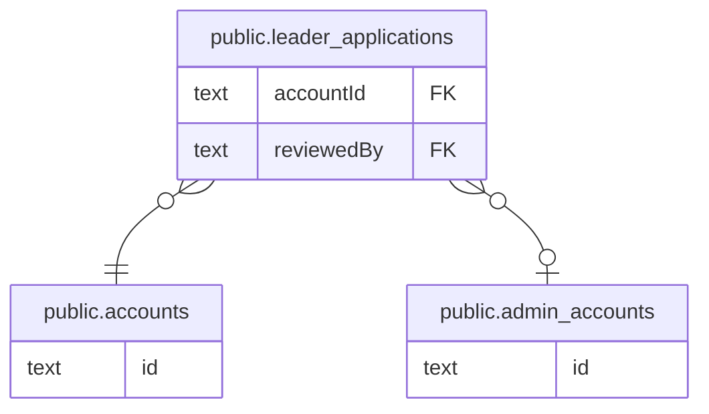

# public.leader_applications

## カラム

| 名前              | 型                                   | 既定値                                     | NULL 可 | 参照先                                            | 説明 |
| ----------------- | ------------------------------------ | ------------------------------------------ | ------- | ------------------------------------------------- | ---- |
| id                | text                                 |                                            | false   |                                                   |      |
| accountId         | text                                 |                                            | false   | [public.accounts](public.accounts.md)             |      |
| status            | "LeaderApplicationStatus"            |                                            | false   |                                                   |      |
| reviewerNote      | text                                 |                                            | true    |                                                   |      |
| projectTitle      | text                                 |                                            | false   |                                                   |      |
| projectSummary    | text                                 |                                            | false   |                                                   |      |
| projectStory      | text                                 |                                            | false   |                                                   |      |
| projectCategory   | text                                 |                                            | false   |                                                   |      |
| prefectureCode    | text                                 |                                            | false   |                                                   |      |
| municipality      | text                                 |                                            | true    |                                                   |      |
| activityContent   | text                                 |                                            | true    |                                                   |      |
| snsLinks          | jsonb                                |                                            | true    |                                                   |      |
| submittedAt       | timestamp(3) without time zone       | CURRENT_TIMESTAMP                          | false   |                                                   |      |
| reviewedAt        | timestamp(3) without time zone       |                                            | true    |                                                   |      |
| createdAt         | timestamp(3) without time zone       | CURRENT_TIMESTAMP                          | false   |                                                   |      |
| updatedAt         | timestamp(3) without time zone       |                                            | false   |                                                   |      |
| reviewedBy        | text                                 |                                            | true    | [public.admin_accounts](public.admin_accounts.md) |      |
| phoneNumber       | text                                 |                                            | true    |                                                   |      |
| progress          | "ProjectPhase"                       | 'PLANNING'::"ProjectPhase"                 | false   |                                                   |      |
| recruitmentTypes  | "LeaderApplicationRecruitmentType"[] | '{}'::"LeaderApplicationRecruitmentType"[] | false   |                                                   |      |
| eventLocation     | text                                 |                                            | true    |                                                   |      |
| eventPeriod       | text                                 |                                            | true    |                                                   |      |
| recruitCount      | integer                              |                                            | true    |                                                   |      |
| skillItemNeeds    | text                                 |                                            | true    |                                                   |      |
| skillItemDeadline | text                                 |                                            | true    |                                                   |      |
| timeReturn        | text                                 |                                            | true    |                                                   |      |
| skillItemReturn   | text                                 |                                            | true    |                                                   |      |
| experienceOffered | text                                 |                                            | false   |                                                   |      |

## 領域別のビュー

| 名前                                     | 定義                                                     |
| ---------------------------------------- | -------------------------------------------------------- |
| [アカウントと応募](viewpoint-account.md) | 一般ユーザーのアカウントと、リーダー応募・運営による審査 |

## 制約

| 名前                                | 型          | 定義                                                                                          |
| ----------------------------------- | ----------- | --------------------------------------------------------------------------------------------- |
| leader_applications_reviewedBy_fkey | FOREIGN KEY | FOREIGN KEY ("reviewedBy") REFERENCES admin_accounts(id) ON UPDATE CASCADE ON DELETE RESTRICT |
| leader_applications_accountId_fkey  | FOREIGN KEY | FOREIGN KEY ("accountId") REFERENCES accounts(id) ON UPDATE CASCADE ON DELETE CASCADE         |
| leader_applications_pkey            | PRIMARY KEY | PRIMARY KEY (id)                                                                              |

## インデックス

| 名前                                | 定義                                                                                                         |
| ----------------------------------- | ------------------------------------------------------------------------------------------------------------ |
| leader_applications_pkey            | CREATE UNIQUE INDEX leader_applications_pkey ON public.leader_applications USING btree (id)                  |
| leader_applications_accountId_idx   | CREATE INDEX "leader_applications_accountId_idx" ON public.leader_applications USING btree ("accountId")     |
| leader_applications_reviewedBy_idx  | CREATE INDEX "leader_applications_reviewedBy_idx" ON public.leader_applications USING btree ("reviewedBy")   |
| leader_applications_status_idx      | CREATE INDEX leader_applications_status_idx ON public.leader_applications USING btree (status)               |
| leader_applications_submittedAt_idx | CREATE INDEX "leader_applications_submittedAt_idx" ON public.leader_applications USING btree ("submittedAt") |

## ER 図

---

> Generated by [tbls](https://github.com/k1LoW/tbls)
