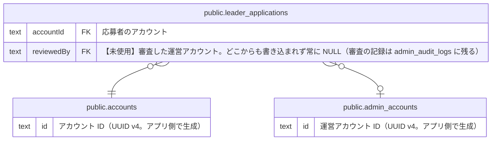

# public.leader_applications

## 説明

リーダー応募（リーダーになるための申請）と運営の審査結果。応募内容は送信時点のスナップショットで、承認時に作られる projects とは参照でつながらない。ドメインの LeaderApplication 集約（project 系の列は ProjectDraft、連絡先・募集情報の列は LeaderApplicationSnapshot に載る）

## カラム

| 名前              | 型                                   | 既定値                                     | NULL 可 | 参照先                                            | 説明                                                                                                      |
| ----------------- | ------------------------------------ | ------------------------------------------ | ------- | ------------------------------------------------- | --------------------------------------------------------------------------------------------------------- |
| id                | text                                 |                                            | false   |                                                   | 応募 ID（UUID v4。アプリ側で生成）                                                                        |
| accountId         | text                                 |                                            | false   | [public.accounts](public.accounts.md)             | 応募者のアカウント                                                                                        |
| status            | "LeaderApplicationStatus"            |                                            | false   |                                                   | PENDING=審査待ち / APPROVED=承認 / REJECTED=却下。承認・却下のあとは変わらない                            |
| reviewerNote      | text                                 |                                            | true    |                                                   | 却下理由（却下するときは必須。最大 2000 文字）                                                            |
| projectTitle      | text                                 |                                            | false   |                                                   | 立ち上げたいプロジェクトのタイトル（最大 60 文字）                                                        |
| projectSummary    | text                                 |                                            | false   |                                                   | プロジェクトの概要（最大 150 文字）                                                                       |
| projectStory      | text                                 |                                            | false   |                                                   | プロジェクトのストーリー（Markdown。最大 300 文字）                                                       |
| projectCategory   | text                                 |                                            | false   |                                                   | カテゴリ（MANUFACTURING / FOOD / NATURE / EVENT。CATEGORY_MASTER の値）                                   |
| prefectureCode    | text                                 |                                            | false   |                                                   | 活動場所の都道府県コード（JIS X 0401: 01〜47）                                                            |
| municipality      | text                                 |                                            | true    |                                                   | 活動場所の市区町村（任意。最大 50 文字）                                                                  |
| activityContent   | text                                 |                                            | true    |                                                   | 活動内容（募集の種類に TIME を含むときは必須。最大 200 文字）                                             |
| snsLinks          | jsonb                                |                                            | true    |                                                   | SNS リンク（x / instagram / facebook / website の URL。それぞれ任意。JSON）                               |
| submittedAt       | timestamp(3) without time zone       | CURRENT_TIMESTAMP                          | false   |                                                   | 応募した日時                                                                                              |
| reviewedAt        | timestamp(3) without time zone       |                                            | true    |                                                   | 運営が承認・却下した日時。審査前は NULL                                                                   |
| createdAt         | timestamp(3) without time zone       | CURRENT_TIMESTAMP                          | false   |                                                   | 作成日時                                                                                                  |
| updatedAt         | timestamp(3) without time zone       |                                            | false   |                                                   | 更新日時（アプリ側で設定する）                                                                            |
| reviewedBy        | text                                 |                                            | true    | [public.admin_accounts](public.admin_accounts.md) | 【未使用】審査した運営アカウント。どこからも書き込まれず常に NULL（審査の記録は admin_audit_logs に残る） |
| phoneNumber       | text                                 |                                            | true    |                                                   | 応募時の電話番号（任意。最大 20 文字）。accounts.phoneNumber にも同じ値を保存する                         |
| progress          | "ProjectPhase"                       | 'PLANNING'::"ProjectPhase"                 | false   |                                                   | 応募時点のプロジェクトの進み具合（VISION / PLANNING / READY / EXECUTION / ONGOING）                       |
| recruitmentTypes  | "LeaderApplicationRecruitmentType"[] | '{}'::"LeaderApplicationRecruitmentType"[] | false   |                                                   | 出したい募集の種類（TIME=時間（やる気）での支援 / SKILL_ITEM=スキル・モノでの支援。1 つ以上）             |
| eventLocation     | text                                 |                                            | true    |                                                   | 開催場所（TIME を含むときは必須。最大 200 文字）                                                          |
| eventPeriod       | text                                 |                                            | true    |                                                   | 実施期間（TIME を含むときは必須。最大 200 文字の自由記述）                                                |
| recruitCount      | integer                              |                                            | true    |                                                   | 募集人数（TIME を含むときは必須。1〜1000）                                                                |
| skillItemNeeds    | text                                 |                                            | true    |                                                   | 募集したいスキル・モノの内容（SKILL_ITEM を含むときは必須。最大 200 文字）                                |
| skillItemDeadline | text                                 |                                            | true    |                                                   | スキル・モノの募集期限（SKILL_ITEM を含むときは必須。最大 200 文字の自由記述）                            |
| timeReturn        | text                                 |                                            | true    |                                                   | 時間で支援した人へのリターン（TIME を含むときは必須。最大 200 文字）                                      |
| skillItemReturn   | text                                 |                                            | true    |                                                   | スキル・モノで支援した人へのリターン（SKILL_ITEM を含むときは必須。最大 200 文字）                        |
| experienceOffered | text                                 |                                            | false   |                                                   | サポーターが体験できること（必須。最大 150 文字）                                                         |

## 領域別のビュー

| 名前                                     | 定義                                                     |
| ---------------------------------------- | -------------------------------------------------------- |
| [アカウントと応募](viewpoint-account.md) | 一般ユーザーのアカウントと、リーダー応募・運営による審査 |

## 制約

| 名前                                | 型          | 定義                                                                                          |
| ----------------------------------- | ----------- | --------------------------------------------------------------------------------------------- |
| leader_applications_reviewedBy_fkey | FOREIGN KEY | FOREIGN KEY ("reviewedBy") REFERENCES admin_accounts(id) ON UPDATE CASCADE ON DELETE RESTRICT |
| leader_applications_accountId_fkey  | FOREIGN KEY | FOREIGN KEY ("accountId") REFERENCES accounts(id) ON UPDATE CASCADE ON DELETE CASCADE         |
| leader_applications_pkey            | PRIMARY KEY | PRIMARY KEY (id)                                                                              |

## インデックス

| 名前                                | 定義                                                                                                         |
| ----------------------------------- | ------------------------------------------------------------------------------------------------------------ |
| leader_applications_pkey            | CREATE UNIQUE INDEX leader_applications_pkey ON public.leader_applications USING btree (id)                  |
| leader_applications_accountId_idx   | CREATE INDEX "leader_applications_accountId_idx" ON public.leader_applications USING btree ("accountId")     |
| leader_applications_reviewedBy_idx  | CREATE INDEX "leader_applications_reviewedBy_idx" ON public.leader_applications USING btree ("reviewedBy")   |
| leader_applications_status_idx      | CREATE INDEX leader_applications_status_idx ON public.leader_applications USING btree (status)               |
| leader_applications_submittedAt_idx | CREATE INDEX "leader_applications_submittedAt_idx" ON public.leader_applications USING btree ("submittedAt") |

## ER 図

---

> Generated by [tbls](https://github.com/k1LoW/tbls)
