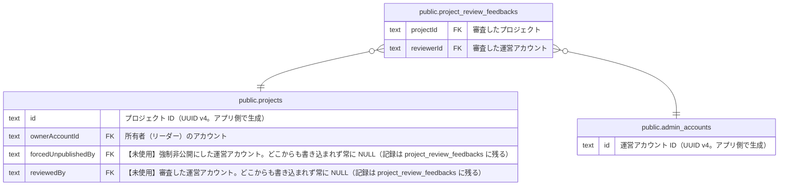

# public.project_review_feedbacks

## 説明

プロジェクトの公開審査の履歴（承認・差戻・強制非公開）。差戻が繰り返されても全件残る。ドメインの ProjectReviewFeedback（Project のサブエンティティ）

## カラム

| 名前       | 型                             | 既定値            | NULL 可 | 参照先                                            | 説明                                                                       |
| ---------- | ------------------------------ | ----------------- | ------- | ------------------------------------------------- | -------------------------------------------------------------------------- |
| id         | text                           |                   | false   |                                                   | 審査履歴 ID（UUID v4。アプリ側で生成）                                     |
| projectId  | text                           |                   | false   | [public.projects](public.projects.md)             | 審査したプロジェクト                                                       |
| reviewerId | text                           |                   | false   | [public.admin_accounts](public.admin_accounts.md) | 審査した運営アカウント                                                     |
| action     | "ReviewAction"                 |                   | false   |                                                   | 審査の結果（APPROVED=承認 / REJECTED=差戻 / FORCE_UNPUBLISHED=強制非公開） |
| note       | text                           |                   | true    |                                                   | 運営からのコメント（差戻・強制非公開では必須。最大 2000 文字）             |
| reviewedAt | timestamp(3) without time zone | CURRENT_TIMESTAMP | false   |                                                   | 審査した日時                                                               |
| createdAt  | timestamp(3) without time zone | CURRENT_TIMESTAMP | false   |                                                   | 作成日時                                                                   |

## 領域別のビュー

| 名前                                           | 定義                                         |
| ---------------------------------------------- | -------------------------------------------- |
| [プロジェクトと公開審査](viewpoint-project.md) | プロジェクト本体と、運営による公開審査の履歴 |

## 制約

| 名前                                     | 型          | 定義                                                                                          |
| ---------------------------------------- | ----------- | --------------------------------------------------------------------------------------------- |
| project_review_feedbacks_reviewerId_fkey | FOREIGN KEY | FOREIGN KEY ("reviewerId") REFERENCES admin_accounts(id) ON UPDATE CASCADE ON DELETE RESTRICT |
| project_review_feedbacks_projectId_fkey  | FOREIGN KEY | FOREIGN KEY ("projectId") REFERENCES projects(id) ON UPDATE CASCADE ON DELETE CASCADE         |
| project_review_feedbacks_pkey            | PRIMARY KEY | PRIMARY KEY (id)                                                                              |

## インデックス

| 名前                                    | 定義                                                                                                                 |
| --------------------------------------- | -------------------------------------------------------------------------------------------------------------------- |
| project_review_feedbacks_pkey           | CREATE UNIQUE INDEX project_review_feedbacks_pkey ON public.project_review_feedbacks USING btree (id)                |
| project_review_feedbacks_projectId_idx  | CREATE INDEX "project_review_feedbacks_projectId_idx" ON public.project_review_feedbacks USING btree ("projectId")   |
| project_review_feedbacks_reviewedAt_idx | CREATE INDEX "project_review_feedbacks_reviewedAt_idx" ON public.project_review_feedbacks USING btree ("reviewedAt") |
| project_review_feedbacks_reviewerId_idx | CREATE INDEX "project_review_feedbacks_reviewerId_idx" ON public.project_review_feedbacks USING btree ("reviewerId") |

## ER 図

---

> Generated by [tbls](https://github.com/k1LoW/tbls)
