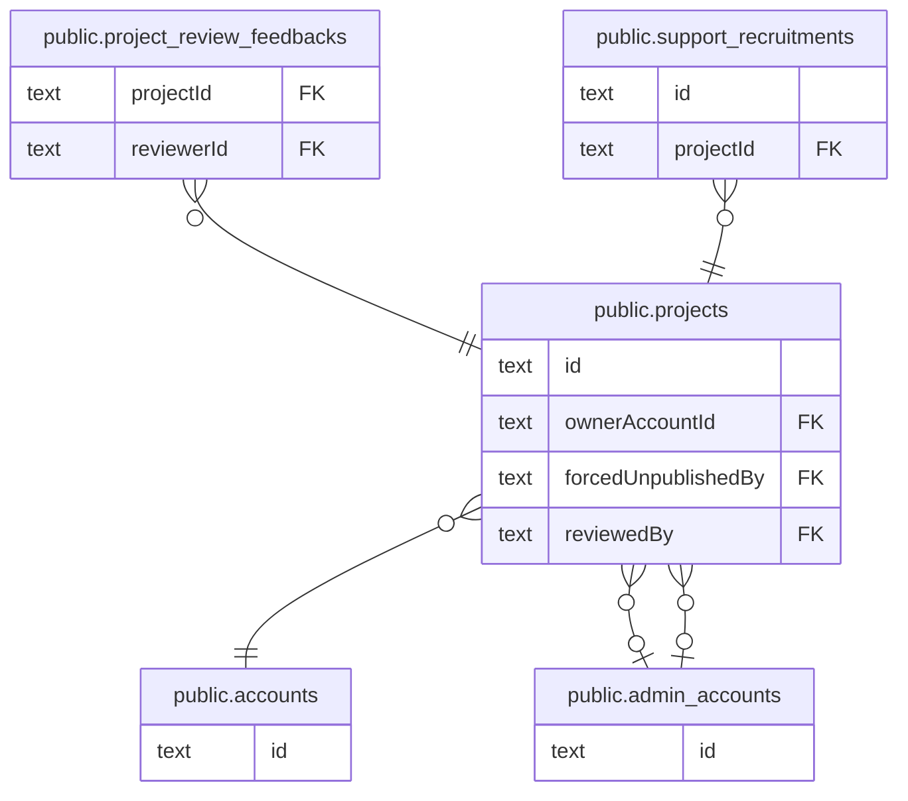

# public.projects

## カラム

| 名前                | 型                             | 既定値                   | NULL 可 | 参照元                                                                                                                              | 参照先                                            | 説明 |
| ------------------- | ------------------------------ | ------------------------ | ------- | ----------------------------------------------------------------------------------------------------------------------------------- | ------------------------------------------------- | ---- |
| id                  | text                           |                          | false   | [public.project_review_feedbacks](public.project_review_feedbacks.md) [public.support_recruitments](public.support_recruitments.md) |                                                   |      |
| ownerAccountId      | text                           |                          | false   |                                                                                                                                     | [public.accounts](public.accounts.md)             |      |
| slug                | text                           |                          | true    |                                                                                                                                     |                                                   |      |
| title               | text                           |                          | false   |                                                                                                                                     |                                                   |      |
| summary             | text                           |                          | true    |                                                                                                                                     |                                                   |      |
| story               | text                           |                          | true    |                                                                                                                                     |                                                   |      |
| leaderIntro         | text                           |                          | true    |                                                                                                                                     |                                                   |      |
| coverImageUrl       | text                           |                          | true    |                                                                                                                                     |                                                   |      |
| category            | text                           |                          | true    |                                                                                                                                     |                                                   |      |
| prefectureCode      | text                           |                          | true    |                                                                                                                                     |                                                   |      |
| municipality        | text                           |                          | true    |                                                                                                                                     |                                                   |      |
| snsLinks            | jsonb                          |                          | true    |                                                                                                                                     |                                                   |      |
| status              | "PublishStatus"                | 'DRAFT'::"PublishStatus" | false   |                                                                                                                                     |                                                   |      |
| phase               | "ProjectPhase"                 | 'VISION'::"ProjectPhase" | false   |                                                                                                                                     |                                                   |      |
| publishRequestedAt  | timestamp(3) without time zone |                          | true    |                                                                                                                                     |                                                   |      |
| publishedAt         | timestamp(3) without time zone |                          | true    |                                                                                                                                     |                                                   |      |
| createdAt           | timestamp(3) without time zone | CURRENT_TIMESTAMP        | false   |                                                                                                                                     |                                                   |      |
| updatedAt           | timestamp(3) without time zone |                          | false   |                                                                                                                                     |                                                   |      |
| activityPlan        | text                           |                          | true    |                                                                                                                                     |                                                   |      |
| forcedUnpublishedBy | text                           |                          | true    |                                                                                                                                     | [public.admin_accounts](public.admin_accounts.md) |      |
| reviewedBy          | text                           |                          | true    |                                                                                                                                     | [public.admin_accounts](public.admin_accounts.md) |      |

## 領域別のビュー

| 名前                                                    | 定義                                             |
| ------------------------------------------------------- | ------------------------------------------------ |
| [プロジェクトと公開審査](viewpoint-project.md)          | プロジェクト本体と、運営による公開審査の履歴     |
| [サポート募集（未実装 #212）](viewpoint-recruitment.md) | スキーマだけ存在し、コードはまだ実装されていない |

## 制約

| 名前                              | 型          | 定義                                                                                                   |
| --------------------------------- | ----------- | ------------------------------------------------------------------------------------------------------ |
| projects_forcedUnpublishedBy_fkey | FOREIGN KEY | FOREIGN KEY ("forcedUnpublishedBy") REFERENCES admin_accounts(id) ON UPDATE CASCADE ON DELETE RESTRICT |
| projects_reviewedBy_fkey          | FOREIGN KEY | FOREIGN KEY ("reviewedBy") REFERENCES admin_accounts(id) ON UPDATE CASCADE ON DELETE RESTRICT          |
| projects_ownerAccountId_fkey      | FOREIGN KEY | FOREIGN KEY ("ownerAccountId") REFERENCES accounts(id) ON UPDATE CASCADE ON DELETE CASCADE             |
| projects_pkey                     | PRIMARY KEY | PRIMARY KEY (id)                                                                                       |

## インデックス

| 名前                             | 定義                                                                                                   |
| -------------------------------- | ------------------------------------------------------------------------------------------------------ |
| projects_pkey                    | CREATE UNIQUE INDEX projects_pkey ON public.projects USING btree (id)                                  |
| projects_category_idx            | CREATE INDEX projects_category_idx ON public.projects USING btree (category)                           |
| projects_forcedUnpublishedBy_idx | CREATE INDEX "projects_forcedUnpublishedBy_idx" ON public.projects USING btree ("forcedUnpublishedBy") |
| projects_ownerAccountId_idx      | CREATE INDEX "projects_ownerAccountId_idx" ON public.projects USING btree ("ownerAccountId")           |
| projects_prefectureCode_idx      | CREATE INDEX "projects_prefectureCode_idx" ON public.projects USING btree ("prefectureCode")           |
| projects_publishedAt_idx         | CREATE INDEX "projects_publishedAt_idx" ON public.projects USING btree ("publishedAt")                 |
| projects_reviewedBy_idx          | CREATE INDEX "projects_reviewedBy_idx" ON public.projects USING btree ("reviewedBy")                   |
| projects_slug_key                | CREATE UNIQUE INDEX projects_slug_key ON public.projects USING btree (slug)                            |
| projects_status_idx              | CREATE INDEX projects_status_idx ON public.projects USING btree (status)                               |

## ER 図

---

> Generated by [tbls](https://github.com/k1LoW/tbls)
