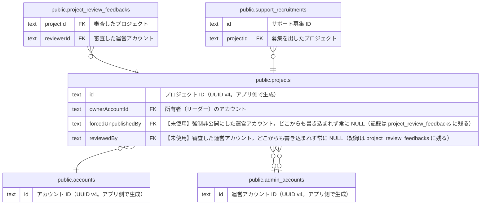

# public.projects

## 説明

リーダーが立ち上げるプロジェクト。公開審査（DRAFT → PENDING_REVIEW → PUBLISHED）を持つ。リーダー応募の承認時に、応募内容から下書きが作られる。ドメインの Project 集約

## カラム

| 名前                | 型                             | 既定値                   | NULL 可 | 参照元                                                                                                                              | 参照先                                            | 説明                                                                                                                          |
| ------------------- | ------------------------------ | ------------------------ | ------- | ----------------------------------------------------------------------------------------------------------------------------------- | ------------------------------------------------- | ----------------------------------------------------------------------------------------------------------------------------- |
| id                  | text                           |                          | false   | [public.project_review_feedbacks](public.project_review_feedbacks.md) [public.support_recruitments](public.support_recruitments.md) |                                                   | プロジェクト ID（UUID v4。アプリ側で生成）                                                                                    |
| ownerAccountId      | text                           |                          | false   |                                                                                                                                     | [public.accounts](public.accounts.md)             | 所有者（リーダー）のアカウント                                                                                                |
| slug                | text                           |                          | true    |                                                                                                                                     |                                                   | 公開ページ URL（/projects/{slug}）に使う文字列。初回の公開承認で id と同じ値を発行し、非公開にしても残す。初回承認までは NULL |
| title               | text                           |                          | false   |                                                                                                                                     |                                                   | タイトル（1〜100 文字）                                                                                                       |
| summary             | text                           |                          | true    |                                                                                                                                     |                                                   | 概要（最大 300 文字。公開申請に必須）                                                                                         |
| story               | text                           |                          | true    |                                                                                                                                     |                                                   | 本文（Markdown。最大 10000 文字。公開申請に必須）。ドメインでは body                                                          |
| leaderIntro         | text                           |                          | true    |                                                                                                                                     |                                                   | リーダー紹介（最大 2000 文字。公開申請に必須）。ドメインでは leaderIntroduction                                               |
| coverImageUrl       | text                           |                          | true    |                                                                                                                                     |                                                   | カバー画像の URL（公開申請に必須）                                                                                            |
| category            | text                           |                          | true    |                                                                                                                                     |                                                   | カテゴリ（MANUFACTURING / FOOD / NATURE / EVENT。公開申請に必須）                                                             |
| prefectureCode      | text                           |                          | true    |                                                                                                                                     |                                                   | 活動場所の都道府県コード（JIS X 0401: 01〜47。公開申請に必須）。ドメインでは location の一部                                  |
| municipality        | text                           |                          | true    |                                                                                                                                     |                                                   | 活動場所の市区町村（任意）。ドメインでは location の一部                                                                      |
| snsLinks            | jsonb                          |                          | true    |                                                                                                                                     |                                                   | SNS リンク（x / instagram / facebook / website の URL。それぞれ任意。JSON）                                                   |
| status              | "PublishStatus"                | 'DRAFT'::"PublishStatus" | false   |                                                                                                                                     |                                                   | 公開状態（DRAFT=下書き / PENDING_REVIEW=審査待ち / PUBLISHED=公開中）。ドメインでは publishStatus                             |
| phase               | "ProjectPhase"                 | 'VISION'::"ProjectPhase" | false   |                                                                                                                                     |                                                   | 進み具合のラベル（VISION / PLANNING / READY / EXECUTION / ONGOING）。どの値にも自由に切り替えられる                           |
| publishRequestedAt  | timestamp(3) without time zone |                          | true    |                                                                                                                                     |                                                   | 公開申請した日時。下書き（DRAFT）に戻ると NULL                                                                                |
| publishedAt         | timestamp(3) without time zone |                          | true    |                                                                                                                                     |                                                   | 運営が公開を承認した日時。下書き（DRAFT）に戻ると NULL                                                                        |
| createdAt           | timestamp(3) without time zone | CURRENT_TIMESTAMP        | false   |                                                                                                                                     |                                                   | 作成日時                                                                                                                      |
| updatedAt           | timestamp(3) without time zone |                          | false   |                                                                                                                                     |                                                   | 更新日時（アプリ側で設定する）                                                                                                |
| activityPlan        | text                           |                          | true    |                                                                                                                                     |                                                   | 活動計画（任意。最大 1000 文字。公開申請にも必須ではない）                                                                    |
| forcedUnpublishedBy | text                           |                          | true    |                                                                                                                                     | [public.admin_accounts](public.admin_accounts.md) | 【未使用】強制非公開にした運営アカウント。どこからも書き込まれず常に NULL（記録は project_review_feedbacks に残る）           |
| reviewedBy          | text                           |                          | true    |                                                                                                                                     | [public.admin_accounts](public.admin_accounts.md) | 【未使用】審査した運営アカウント。どこからも書き込まれず常に NULL（記録は project_review_feedbacks に残る）                   |

## 領域別のビュー

| 名前                                                    | 定義                                             |
| ------------------------------------------------------- | ------------------------------------------------ |
| [プロジェクトと公開審査](viewpoint-project.md)          | プロジェクト本体と、運営による公開審査の履歴     |
| [サポート募集（未実装 #212）](viewpoint-recruitment.md) | スキーマだけ存在し、コードはまだ実装されていない |

## 制約

| 名前                              | 型          | 定義                                                                                                   |
| --------------------------------- | ----------- | ------------------------------------------------------------------------------------------------------ |
| projects_forcedUnpublishedBy_fkey | FOREIGN KEY | FOREIGN KEY ("forcedUnpublishedBy") REFERENCES admin_accounts(id) ON UPDATE CASCADE ON DELETE RESTRICT |
| projects_reviewedBy_fkey          | FOREIGN KEY | FOREIGN KEY ("reviewedBy") REFERENCES admin_accounts(id) ON UPDATE CASCADE ON DELETE RESTRICT          |
| projects_ownerAccountId_fkey      | FOREIGN KEY | FOREIGN KEY ("ownerAccountId") REFERENCES accounts(id) ON UPDATE CASCADE ON DELETE CASCADE             |
| projects_pkey                     | PRIMARY KEY | PRIMARY KEY (id)                                                                                       |

## インデックス

| 名前                             | 定義                                                                                                   |
| -------------------------------- | ------------------------------------------------------------------------------------------------------ |
| projects_pkey                    | CREATE UNIQUE INDEX projects_pkey ON public.projects USING btree (id)                                  |
| projects_category_idx            | CREATE INDEX projects_category_idx ON public.projects USING btree (category)                           |
| projects_forcedUnpublishedBy_idx | CREATE INDEX "projects_forcedUnpublishedBy_idx" ON public.projects USING btree ("forcedUnpublishedBy") |
| projects_ownerAccountId_idx      | CREATE INDEX "projects_ownerAccountId_idx" ON public.projects USING btree ("ownerAccountId")           |
| projects_prefectureCode_idx      | CREATE INDEX "projects_prefectureCode_idx" ON public.projects USING btree ("prefectureCode")           |
| projects_publishedAt_idx         | CREATE INDEX "projects_publishedAt_idx" ON public.projects USING btree ("publishedAt")                 |
| projects_reviewedBy_idx          | CREATE INDEX "projects_reviewedBy_idx" ON public.projects USING btree ("reviewedBy")                   |
| projects_slug_key                | CREATE UNIQUE INDEX projects_slug_key ON public.projects USING btree (slug)                            |
| projects_status_idx              | CREATE INDEX projects_status_idx ON public.projects USING btree (status)                               |

## ER 図

---

> Generated by [tbls](https://github.com/k1LoW/tbls)
