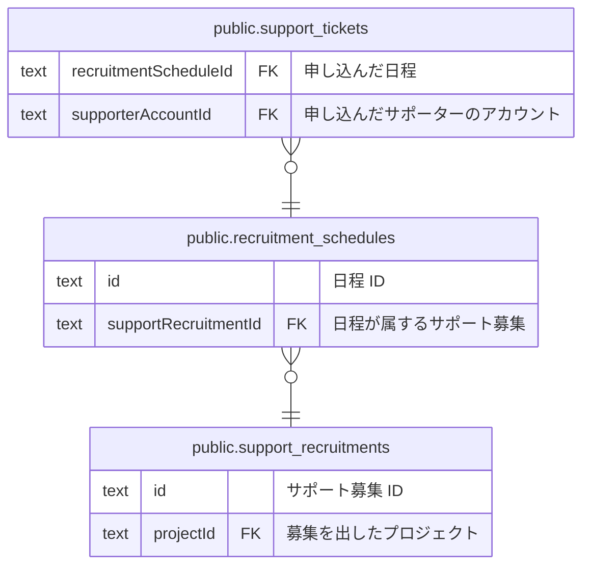

# public.recruitment_schedules

## 説明

【未実装 #212】サポート募集の日程。1 募集につき 1 日 1 行で、その日の受付時間帯と、1 時間ごとの定員を持つ

## カラム

| 名前                 | 型                             | 既定値                 | NULL 可 | 参照元                                              | 参照先                                                        | 説明                                                                                         |
| -------------------- | ------------------------------ | ---------------------- | ------- | --------------------------------------------------- | ------------------------------------------------------------- | -------------------------------------------------------------------------------------------- |
| id                   | text                           |                        | false   | [public.support_tickets](public.support_tickets.md) |                                                               | 日程 ID                                                                                      |
| supportRecruitmentId | text                           |                        | false   |                                                     | [public.support_recruitments](public.support_recruitments.md) | 日程が属するサポート募集                                                                     |
| date                 | date                           |                        | false   |                                                     |                                                               | 開催日（JST のカレンダー日）                                                                 |
| startTime            | text                           |                        | false   |                                                     |                                                               | 受付時間帯の開始時刻（HH:MM 形式の JST）                                                     |
| endTime              | text                           |                        | false   |                                                     |                                                               | 受付時間帯の終了時刻（HH:MM 形式の JST）。過ぎると新規の申し込みを締め切る想定               |
| capacityPerHour      | integer                        |                        | false   |                                                     |                                                               | 1 時間ごとの定員（人数）。申し込みは先着順で、またがる全時間帯が定員内に収まる必要がある想定 |
| approvalMode         | "ApprovalMode"                 | 'AUTO'::"ApprovalMode" | false   |                                                     |                                                               | 承認モード（AUTO=申し込んだ時点で確定 / MANUAL=リーダーの承認で確定）                        |
| createdAt            | timestamp(3) without time zone | CURRENT_TIMESTAMP      | false   |                                                     |                                                               | 作成日時                                                                                     |
| updatedAt            | timestamp(3) without time zone |                        | false   |                                                     |                                                               | 更新日時（アプリ側で設定する）                                                               |

## 領域別のビュー

| 名前                                                    | 定義                                             |
| ------------------------------------------------------- | ------------------------------------------------ |
| [サポート募集（未実装 #212）](viewpoint-recruitment.md) | スキーマだけ存在し、コードはまだ実装されていない |

## 制約

| 名前                                            | 型          | 定義                                                                                                         |
| ----------------------------------------------- | ----------- | ------------------------------------------------------------------------------------------------------------ |
| recruitment_schedules_supportRecruitmentId_fkey | FOREIGN KEY | FOREIGN KEY ("supportRecruitmentId") REFERENCES support_recruitments(id) ON UPDATE CASCADE ON DELETE CASCADE |
| recruitment_schedules_pkey                      | PRIMARY KEY | PRIMARY KEY (id)                                                                                             |

## インデックス

| 名前                                                | 定義                                                                                                                                                 |
| --------------------------------------------------- | ---------------------------------------------------------------------------------------------------------------------------------------------------- |
| recruitment_schedules_pkey                          | CREATE UNIQUE INDEX recruitment_schedules_pkey ON public.recruitment_schedules USING btree (id)                                                      |
| recruitment_schedules_date_idx                      | CREATE INDEX recruitment_schedules_date_idx ON public.recruitment_schedules USING btree (date)                                                       |
| recruitment_schedules_supportRecruitmentId_date_key | CREATE UNIQUE INDEX "recruitment_schedules_supportRecruitmentId_date_key" ON public.recruitment_schedules USING btree ("supportRecruitmentId", date) |

## ER 図

---

> Generated by [tbls](https://github.com/k1LoW/tbls)
