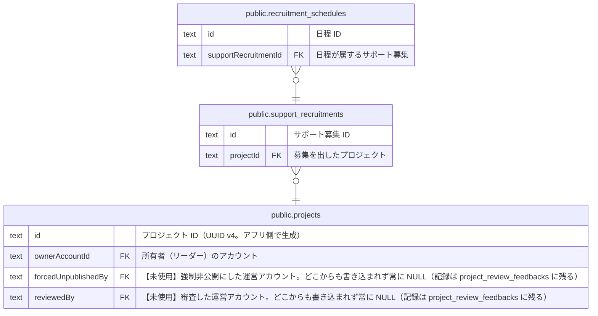

# public.support_recruitments

## 説明

【未実装 #212】サポート募集。プロジェクトに紐づく募集の単位。スキーマだけ存在し、コードはまだ無い

## カラム

| 名前        | 型                             | 既定値                        | NULL 可 | 参照元                                                          | 参照先                                | 説明                                       |
| ----------- | ------------------------------ | ----------------------------- | ------- | --------------------------------------------------------------- | ------------------------------------- | ------------------------------------------ |
| id          | text                           |                               | false   | [public.recruitment_schedules](public.recruitment_schedules.md) |                                       | サポート募集 ID                            |
| projectId   | text                           |                               | false   |                                                                 | [public.projects](public.projects.md) | 募集を出したプロジェクト                   |
| type        | "RecruitmentType"              | 'ACTIVITY'::"RecruitmentType" | false   |                                                                 |                                       | 募集の種類（初回リリースは ACTIVITY のみ） |
| title       | text                           |                               | false   |                                                                 |                                       | 募集のタイトル                             |
| description | text                           |                               | false   |                                                                 |                                       | 募集の説明                                 |
| createdAt   | timestamp(3) without time zone | CURRENT_TIMESTAMP             | false   |                                                                 |                                       | 作成日時                                   |
| updatedAt   | timestamp(3) without time zone |                               | false   |                                                                 |                                       | 更新日時（アプリ側で設定する）             |

## 領域別のビュー

| 名前                                                    | 定義                                             |
| ------------------------------------------------------- | ------------------------------------------------ |
| [サポート募集（未実装 #212）](viewpoint-recruitment.md) | スキーマだけ存在し、コードはまだ実装されていない |

## 制約

| 名前                                | 型          | 定義                                                                                  |
| ----------------------------------- | ----------- | ------------------------------------------------------------------------------------- |
| support_recruitments_projectId_fkey | FOREIGN KEY | FOREIGN KEY ("projectId") REFERENCES projects(id) ON UPDATE CASCADE ON DELETE CASCADE |
| support_recruitments_pkey           | PRIMARY KEY | PRIMARY KEY (id)                                                                      |

## インデックス

| 名前                               | 定義                                                                                                       |
| ---------------------------------- | ---------------------------------------------------------------------------------------------------------- |
| support_recruitments_pkey          | CREATE UNIQUE INDEX support_recruitments_pkey ON public.support_recruitments USING btree (id)              |
| support_recruitments_projectId_idx | CREATE INDEX "support_recruitments_projectId_idx" ON public.support_recruitments USING btree ("projectId") |

## ER 図

---

> Generated by [tbls](https://github.com/k1LoW/tbls)
