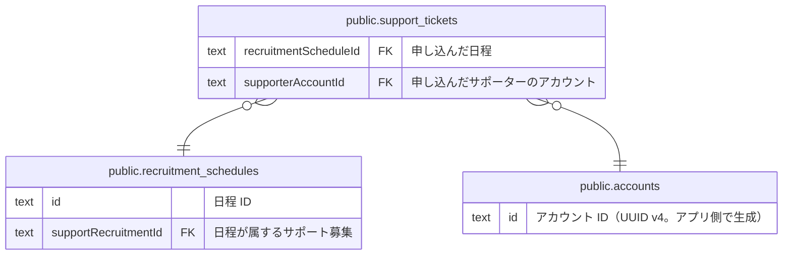

# public.support_tickets

## 説明

【未実装 #212】サポートチケット。サポーターが日程の中の時間帯に参加を申し込んだ記録。チケットは提供する時間の単位を表す言葉で、購入や在庫は無い

## カラム

| 名前                  | 型                             | 既定値                           | NULL 可 | 参照先                                                          | 説明                                                                                                                  |
| --------------------- | ------------------------------ | -------------------------------- | ------- | --------------------------------------------------------------- | --------------------------------------------------------------------------------------------------------------------- |
| id                    | text                           |                                  | false   |                                                                 | サポートチケット ID                                                                                                   |
| recruitmentScheduleId | text                           |                                  | false   | [public.recruitment_schedules](public.recruitment_schedules.md) | 申し込んだ日程                                                                                                        |
| supporterAccountId    | text                           |                                  | false   | [public.accounts](public.accounts.md)                           | 申し込んだサポーターのアカウント                                                                                      |
| duration              | integer                        |                                  | false   |                                                                 | 提供する時間の長さ（時間。チケットの区分 1 / 2 / 4）                                                                  |
| slotStart             | text                           |                                  | false   |                                                                 | 参加を始める時刻（HH:MM 形式の JST。1 時間単位）                                                                      |
| companionCount        | integer                        | 0                                | false   |                                                                 | 一緒に参加する同伴者の人数（申し込んだ本人は含まない想定。同伴者はアカウント不要）                                    |
| status                | "SupportTicketStatus"          | 'PENDING'::"SupportTicketStatus" | false   |                                                                 | 申し込みの状態（PENDING=承認待ち / CONFIRMED=確定 / CANCELLED=取り消し / COMPLETED=完了。COMPLETED にする条件は未決） |
| createdAt             | timestamp(3) without time zone | CURRENT_TIMESTAMP                | false   |                                                                 | 作成日時                                                                                                              |
| updatedAt             | timestamp(3) without time zone |                                  | false   |                                                                 | 更新日時（アプリ側で設定する）                                                                                        |

## 領域別のビュー

| 名前                                                    | 定義                                             |
| ------------------------------------------------------- | ------------------------------------------------ |
| [サポート募集（未実装 #212）](viewpoint-recruitment.md) | スキーマだけ存在し、コードはまだ実装されていない |

## 制約

| 名前                                       | 型          | 定義                                                                                                           |
| ------------------------------------------ | ----------- | -------------------------------------------------------------------------------------------------------------- |
| support_tickets_supporterAccountId_fkey    | FOREIGN KEY | FOREIGN KEY ("supporterAccountId") REFERENCES accounts(id) ON UPDATE CASCADE ON DELETE RESTRICT                |
| support_tickets_recruitmentScheduleId_fkey | FOREIGN KEY | FOREIGN KEY ("recruitmentScheduleId") REFERENCES recruitment_schedules(id) ON UPDATE CASCADE ON DELETE CASCADE |
| support_tickets_pkey                       | PRIMARY KEY | PRIMARY KEY (id)                                                                                               |

## インデックス

| 名前                                      | 定義                                                                                                                     |
| ----------------------------------------- | ------------------------------------------------------------------------------------------------------------------------ |
| support_tickets_pkey                      | CREATE UNIQUE INDEX support_tickets_pkey ON public.support_tickets USING btree (id)                                      |
| support_tickets_recruitmentScheduleId_idx | CREATE INDEX "support_tickets_recruitmentScheduleId_idx" ON public.support_tickets USING btree ("recruitmentScheduleId") |
| support_tickets_status_idx                | CREATE INDEX support_tickets_status_idx ON public.support_tickets USING btree (status)                                   |
| support_tickets_supporterAccountId_idx    | CREATE INDEX "support_tickets_supporterAccountId_idx" ON public.support_tickets USING btree ("supporterAccountId")       |

## ER 図

---

> Generated by [tbls](https://github.com/k1LoW/tbls)
