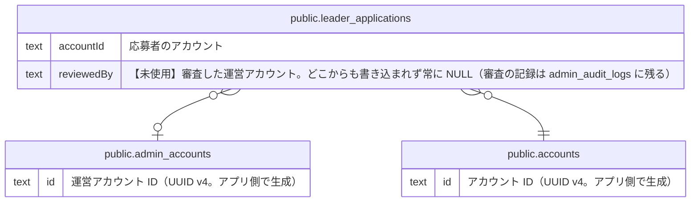

# アカウントと応募

## 説明

一般ユーザーのアカウントと、リーダー応募・運営による審査

## テーブル一覧

| 名前                                                        | カラム  | 説明                                                                                                                                                                                                                                                                            | 型         |
| ----------------------------------------------------------- | ------- | ------------------------------------------------------------------------------------------------------------------------------------------------------------------------------------------------------------------------------------------------------------------------------- | ---------- |
| [public.admin_accounts](public.admin_accounts.md)           | 6       | 運営アカウント（apps/admin にログインする運営メンバー）。一般ユーザーの accounts とは別物。物理削除はせず status で無効化する。ドメインの AdminAccount 集約                                                                                                                     | BASE TABLE |
| [public.accounts](public.accounts.md)                       | 16      | 一般ユーザーのアカウント（サポーター・リーダー）。リーダー応募の送信時に作られ、メールのリンクからパスワードを設定すると有効になる                                                                                                                                              | BASE TABLE |
| [public.leader_applications](public.leader_applications.md) | 28      | リーダー応募（リーダーになるための申請）と運営の審査結果。応募内容は送信時点のスナップショットで、承認時に作られる projects とは参照でつながらない。ドメインの LeaderApplication 集約（project 系の列は ProjectDraft、連絡先・募集情報の列は LeaderApplicationSnapshot に載る） | BASE TABLE |

## ER 図

---

> Generated by [tbls](https://github.com/k1LoW/tbls)
