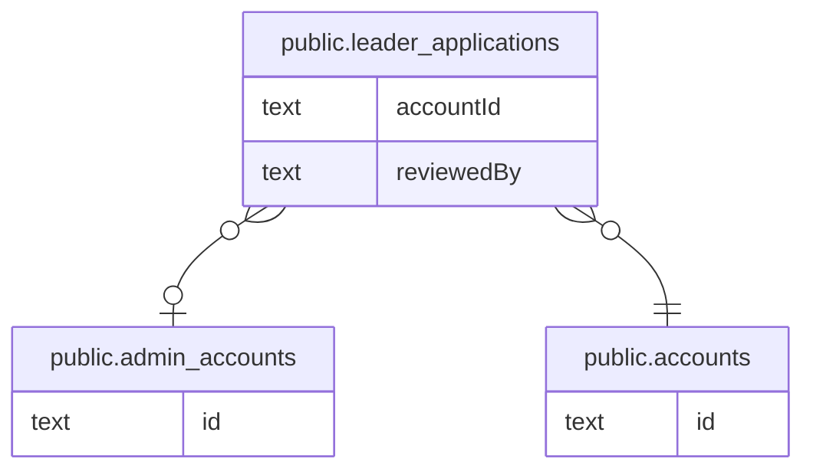

# アカウントと応募

## 説明

一般ユーザーのアカウントと、リーダー応募・運営による審査

## テーブル一覧

| 名前                                                        | カラム  | 説明    | 型         |
| ----------------------------------------------------------- | ------- | ------- | ---------- |
| [public.admin_accounts](public.admin_accounts.md)           | 6       |         | BASE TABLE |
| [public.accounts](public.accounts.md)                       | 16      |         | BASE TABLE |
| [public.leader_applications](public.leader_applications.md) | 28      |         | BASE TABLE |

## ER 図

---

> Generated by [tbls](https://github.com/k1LoW/tbls)
