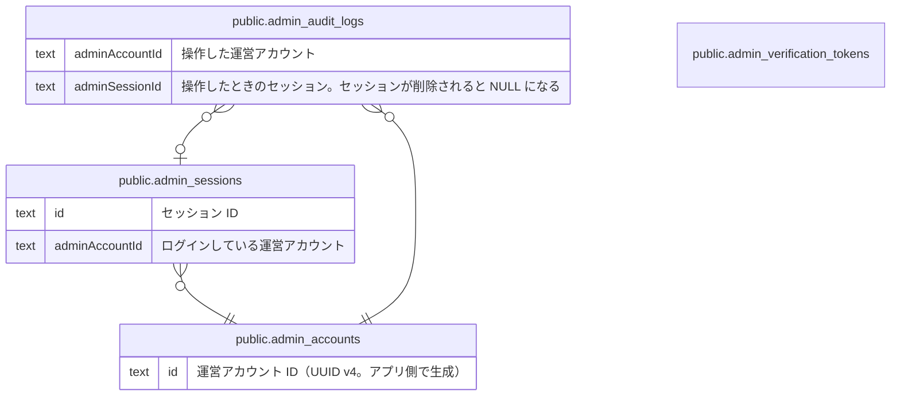

# 運営の認証と監査

## 説明

運営アカウントの Magic Link 認証・セッション・操作ログ

## テーブル一覧

| 名前                                                                    | カラム  | 説明                                                                                                                                                        | 型         |
| ----------------------------------------------------------------------- | ------- | ----------------------------------------------------------------------------------------------------------------------------------------------------------- | ---------- |
| [public.admin_accounts](public.admin_accounts.md)                       | 6       | 運営アカウント（apps/admin にログインする運営メンバー）。一般ユーザーの accounts とは別物。物理削除はせず status で無効化する。ドメインの AdminAccount 集約 | BASE TABLE |
| [public.admin_verification_tokens](public.admin_verification_tokens.md) | 3       | 運営ログイン用 Magic Link のトークン（NextAuth の VerificationToken）。使うと削除され、期限切れのものも定期的に削除される。FK は持たない                    | BASE TABLE |
| [public.admin_sessions](public.admin_sessions.md)                       | 6       | 運営アプリのログインセッション（NextAuth の Database セッション）。有効期間は 1 時間で、使っている間は延長される。期限切れのものは定期的に削除される        | BASE TABLE |
| [public.admin_audit_logs](public.admin_audit_logs.md)                   | 8       | 運営の操作ログ（誰が・いつ・何に対して・何をしたか）。運営画面の操作ログ一覧で見る                                                                          | BASE TABLE |

## ER 図

---

> Generated by [tbls](https://github.com/k1LoW/tbls)
