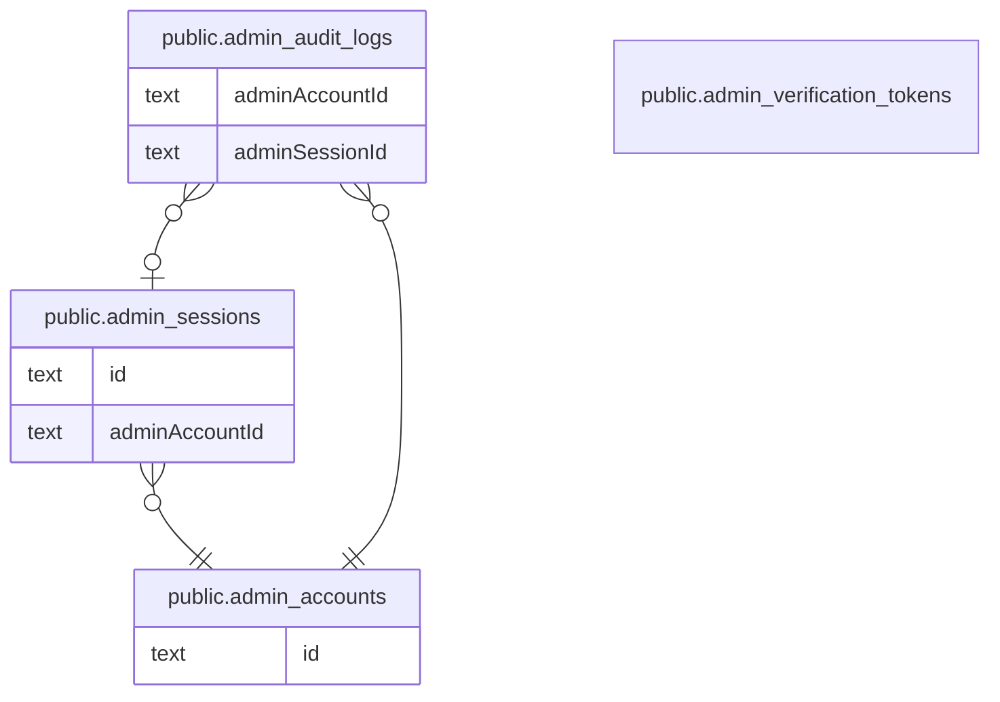

# 運営の認証と監査

## 説明

運営アカウントの Magic Link 認証・セッション・操作ログ

## テーブル一覧

| 名前                                                                    | カラム  | 説明    | 型         |
| ----------------------------------------------------------------------- | ------- | ------- | ---------- |
| [public.admin_accounts](public.admin_accounts.md)                       | 6       |         | BASE TABLE |
| [public.admin_verification_tokens](public.admin_verification_tokens.md) | 3       |         | BASE TABLE |
| [public.admin_sessions](public.admin_sessions.md)                       | 6       |         | BASE TABLE |
| [public.admin_audit_logs](public.admin_audit_logs.md)                   | 8       |         | BASE TABLE |

## ER 図

---

> Generated by [tbls](https://github.com/k1LoW/tbls)
