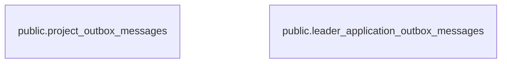

# Outbox（非同期メール送信）

## 説明

DB の更新と同じトランザクションで積む、送信待ちメッセージ

## テーブル一覧

| 名前                                                                                      | カラム  | 説明                                                                                                                   | 型         |
| ----------------------------------------------------------------------------------------- | ------- | ---------------------------------------------------------------------------------------------------------------------- | ---------- |
| [public.project_outbox_messages](public.project_outbox_messages.md)                       | 11      | プロジェクトの公開審査に関する送信待ちメール（Outbox）。状態の変更と同じトランザクションで積み、ワーカーが非同期で送る | BASE TABLE |
| [public.leader_application_outbox_messages](public.leader_application_outbox_messages.md) | 11      | リーダー応募に関する送信待ちメール（Outbox）。応募・審査と同じトランザクションで積み、ワーカーが非同期で送る           | BASE TABLE |

## ER 図

---

> Generated by [tbls](https://github.com/k1LoW/tbls)
