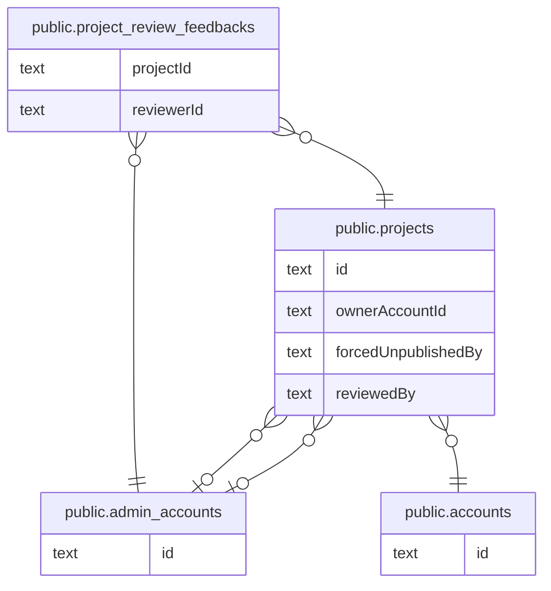

# プロジェクトと公開審査

## 説明

プロジェクト本体と、運営による公開審査の履歴

## テーブル一覧

| 名前                                                                  | カラム  | 説明    | 型         |
| --------------------------------------------------------------------- | ------- | ------- | ---------- |
| [public.admin_accounts](public.admin_accounts.md)                     | 6       |         | BASE TABLE |
| [public.accounts](public.accounts.md)                                 | 16      |         | BASE TABLE |
| [public.projects](public.projects.md)                                 | 21      |         | BASE TABLE |
| [public.project_review_feedbacks](public.project_review_feedbacks.md) | 7       |         | BASE TABLE |

## ER 図

---

> Generated by [tbls](https://github.com/k1LoW/tbls)
