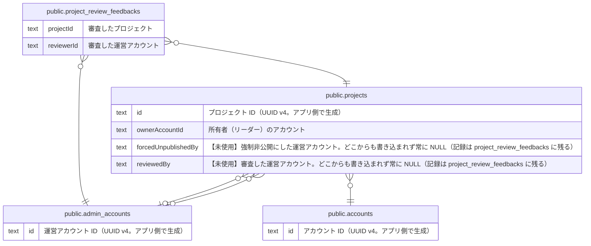

# プロジェクトと公開審査

## 説明

プロジェクト本体と、運営による公開審査の履歴

## テーブル一覧

| 名前                                                                  | カラム  | 説明                                                                                                                                                                  | 型         |
| --------------------------------------------------------------------- | ------- | --------------------------------------------------------------------------------------------------------------------------------------------------------------------- | ---------- |
| [public.admin_accounts](public.admin_accounts.md)                     | 6       | 運営アカウント（apps/admin にログインする運営メンバー）。一般ユーザーの accounts とは別物。物理削除はせず status で無効化する。ドメインの AdminAccount 集約           | BASE TABLE |
| [public.accounts](public.accounts.md)                                 | 16      | 一般ユーザーのアカウント（サポーター・リーダー）。リーダー応募の送信時に作られ、メールのリンクからパスワードを設定すると有効になる                                    | BASE TABLE |
| [public.projects](public.projects.md)                                 | 21      | リーダーが立ち上げるプロジェクト。公開審査（DRAFT → PENDING_REVIEW → PUBLISHED）を持つ。リーダー応募の承認時に、応募内容から下書きが作られる。ドメインの Project 集約 | BASE TABLE |
| [public.project_review_feedbacks](public.project_review_feedbacks.md) | 7       | プロジェクトの公開審査の履歴（承認・差戻・強制非公開）。差戻が繰り返されても全件残る。ドメインの ProjectReviewFeedback（Project のサブエンティティ）                  | BASE TABLE |

## ER 図

---

> Generated by [tbls](https://github.com/k1LoW/tbls)
