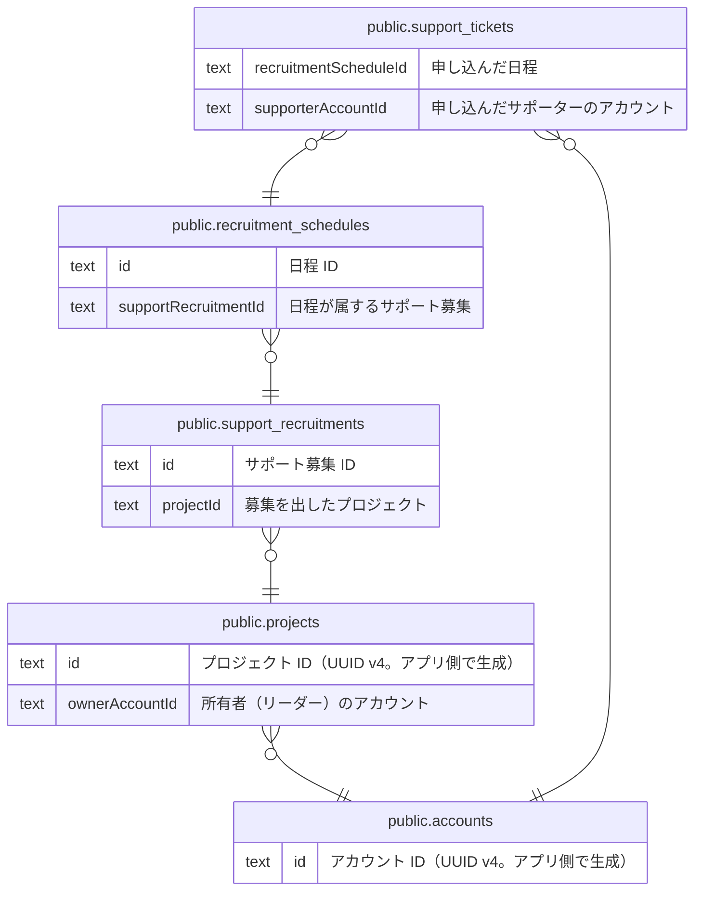

# サポート募集（未実装 #212）

## 説明

スキーマだけ存在し、コードはまだ実装されていない

## テーブル一覧

| 名前                                                            | カラム  | 説明                                                                                                                                                                  | 型         |
| --------------------------------------------------------------- | ------- | --------------------------------------------------------------------------------------------------------------------------------------------------------------------- | ---------- |
| [public.accounts](public.accounts.md)                           | 16      | 一般ユーザーのアカウント（サポーター・リーダー）。リーダー応募の送信時に作られ、メールのリンクからパスワードを設定すると有効になる                                    | BASE TABLE |
| [public.projects](public.projects.md)                           | 21      | リーダーが立ち上げるプロジェクト。公開審査（DRAFT → PENDING_REVIEW → PUBLISHED）を持つ。リーダー応募の承認時に、応募内容から下書きが作られる。ドメインの Project 集約 | BASE TABLE |
| [public.support_recruitments](public.support_recruitments.md)   | 7       | 【未実装 #212】サポート募集。プロジェクトに紐づく募集の単位。スキーマだけ存在し、コードはまだ無い                                                                     | BASE TABLE |
| [public.recruitment_schedules](public.recruitment_schedules.md) | 9       | 【未実装 #212】サポート募集の日程。1 募集につき 1 日 1 行で、その日の受付時間帯と、1 時間ごとの定員を持つ                                                             | BASE TABLE |
| [public.support_tickets](public.support_tickets.md)             | 9       | 【未実装 #212】サポートチケット。サポーターが日程の中の時間帯に参加を申し込んだ記録。チケットは提供する時間の単位を表す言葉で、購入や在庫は無い                       | BASE TABLE |

## ER 図

---

> Generated by [tbls](https://github.com/k1LoW/tbls)
