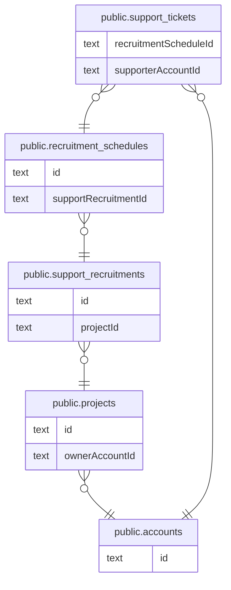

# サポート募集（未実装 #212）

## 説明

スキーマだけ存在し、コードはまだ実装されていない

## テーブル一覧

| 名前                                                            | カラム  | 説明    | 型         |
| --------------------------------------------------------------- | ------- | ------- | ---------- |
| [public.accounts](public.accounts.md)                           | 16      |         | BASE TABLE |
| [public.projects](public.projects.md)                           | 21      |         | BASE TABLE |
| [public.support_recruitments](public.support_recruitments.md)   | 7       |         | BASE TABLE |
| [public.recruitment_schedules](public.recruitment_schedules.md) | 9       |         | BASE TABLE |
| [public.support_tickets](public.support_tickets.md)             | 9       |         | BASE TABLE |

## ER 図

---

> Generated by [tbls](https://github.com/k1LoW/tbls)
