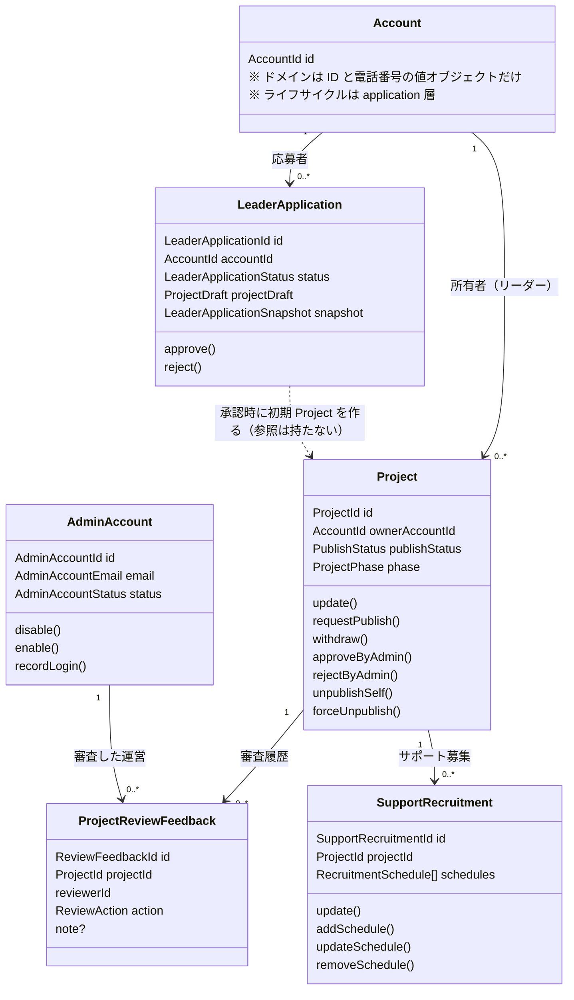
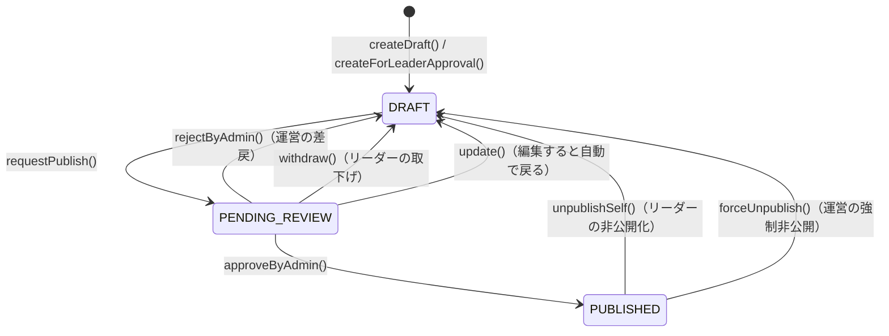
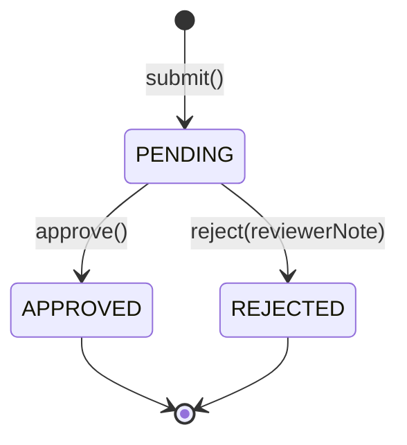
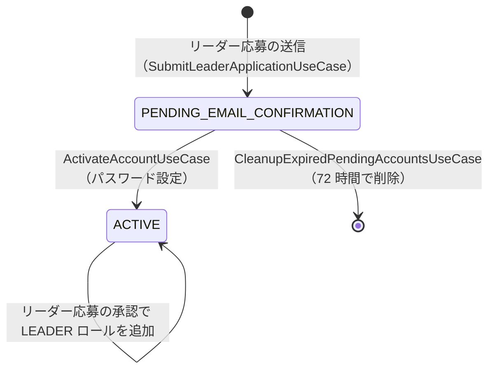
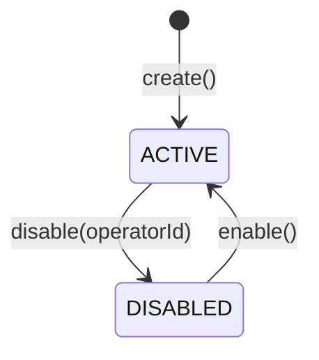
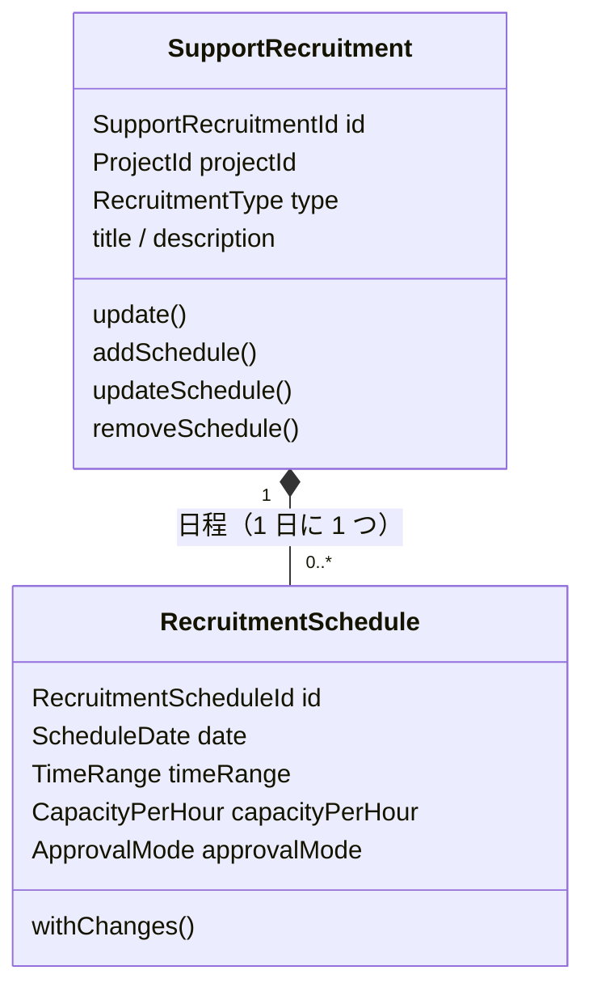

# 02. ドメインモデル

PhysiFun のドメイン（`packages/domain/`）と、それを動かすユースケース（`packages/application/`）の **境界・状態遷移・守るべきルール・設計判断** をまとめた地図。

## このドキュメントの位置づけ

- **目的**: AI / 人間が「どの集約が何を守っていて、どこで何が起きるか」を短時間で掴むための地図
- **正本**: コード。食い違ったらコードが正
- **書かないこと**: フィールドの細かい一覧・文字数上限・列の意味。これらはコードと自動生成物を見る
  - フィールドと上限: 各エンティティ・値オブジェクト（`packages/domain/src/`）と `leader-application/constants.ts`
  - 列の意味: [`docs/db/`](../db/README.md)（`schema.sql` の `COMMENT ON` から自動生成）。列名とドメインの名前の対応は `03_data-model.md` §2
- **揮発度**: 中（集約・状態遷移・ルールの置き場所が変わったときに同じ PR で更新する）
- **関連**:
  - `00_terminology.md` — 用語の対訳
  - `03_data-model.md` — DB 設計の意図（テーブル定義・ER 図は `docs/db/`）
  - `04_security-design.md` — Account / AdminAccount の認証・認可
  - `05_key-flows/` — 状態遷移を起こすフローのシーケンス図

---

## 1. 全体像

| 集約 | 役割 | ドメイン（`packages/domain/src/`） | 実装状況 |
|---|---|---|---|
| `Project`（＋`ProjectReviewFeedback`） | リーダーのプロジェクトと公開審査 | `project/` | ✅ |
| `LeaderApplication` | リーダー応募と運営の審査 | `leader-application/` | ✅ |
| `Account` | 一般ユーザー（サポーター / リーダー） | `account/`（値オブジェクトのみ） | ⚠️ 最小構成（§5） |
| `AdminAccount` | 運営アカウント | `admin-account/` | ✅ |
| `SupportRecruitment`（＋`RecruitmentSchedule`） | サポート募集と日程 | `recruitment/` | 🚧 ドメイン・application・インフラまで（§8） |

**関係の要点:**

- `LeaderApplication` と `Project` の間に **参照は無い**。応募内容はスナップショットとして応募側に残り、承認時に初期 `Project` を作る入力として使うだけ（§4.5）
- `Account`（一般ユーザー）と `AdminAccount`（運営）は **完全に別の集約**。アプリ・Cookie・セッションも分かれている（`04_security-design.md`）
- 運営による審査の記録は、`ProjectReviewFeedback`（プロジェクトの公開審査）と `admin_audit_logs`（運営の全操作。ドメインモデルは無い）に残る

---

## 2. ルールの置き場所（レイヤーの分担）

| レイヤー | 担当すること | 例 |
|---|---|---|
| domain | 集約が自分の状態遷移と不変条件を守る。失敗は `Result` で返す | `Project.requestPublish()` は DRAFT 以外や必須項目の不足を拒否する |
| application | 複数の集約・テーブルにまたがる処理、件数上限、権限、外部サービス（CAPTCHA・レート制限） | 公開承認時の「1 人 PUBLISHED 3 件まで」、応募の重複チェック |
| infrastructure | application の Port を Kysely で実装し、集約・審査履歴・Outbox を **1 つのトランザクション** で書く | `KyselyProjectCommandAdapter` |

- **保存は、ユースケースごとの Port を通す**（`packages/application/src/*/ports/`）。例: `ApproveProjectPublicationPort`
- ⚠️ domain の `repositories/` にあるインターフェースのうち、実装があるのは `AdminAccountRepository` と `RecruitmentRepository` だけ。`ProjectRepository` / `ProjectReviewFeedbackRepository` / `LeaderApplicationRepository` は定義だけで、どこからも使われていない（§10）。`RecruitmentRepository` は、application の port がここから `Pick` して使う（§8.4。実装は infrastructure の `KyselyRecruitmentRepository`）
- 運営アカウントの操作（作成・無効化・有効化）には application のユースケースが無い。`apps/admin` の Route Handler が、エンティティとリポジトリを直接使う

---

## 3. Project 集約

### 3.1 役割

リーダーが立ち上げるプロジェクト。公開審査（DRAFT → PENDING_REVIEW → PUBLISHED）を持つ。

- 作られ方は 2 通り: リーダーが新規作成する（`Project.createDraft`）か、リーダー応募の承認時に応募内容から作られる（`Project.createForLeaderApproval`。§4.5）
- 主な項目: タイトル・概要・本文・リーダー紹介・カバー画像・カテゴリ・場所・SNS リンク・活動計画、公開状態、フェーズ、公開 URL（slug）、公開申請日時・公開日時
- 定義: `packages/domain/src/project/entities/Project.ts`（上限は `PROJECT_LIMITS`）

### 3.2 状態遷移（PublishStatus）

**ガード条件:**

- `requestPublish()`: DRAFT のときだけ。`coverImageUrl` / `category` / `location` / `summary` / `body` / `leaderIntroduction` がすべて入っていること（`activityPlan` は任意）
- `approveByAdmin()` / `rejectByAdmin()` / `withdraw()`: PENDING_REVIEW のときだけ
- `unpublishSelf()` / `forceUnpublish()`: PUBLISHED のときだけ
- 審査待ち（PENDING_REVIEW）の間に `update()` すると、自動で DRAFT に戻る（もう一度申請が必要）

**遷移に伴う値の変化（#262）:**

| 遷移 | `slug` | `publishRequestedAt` | `publishedAt` |
|---|---|---|---|
| `requestPublish()` | — | 申請時刻 | — |
| `approveByAdmin()` | 未発行なら `id` を発行 | 残す | 承認時刻 |
| DRAFT に戻る遷移（上の 5 つ） | 残す（再公開で同じ URL） | `null` | `null` |

> 💡 slug に `id`（UUID）をそのまま使うのは、一意性が保証されていて重複の処理が要らないため。日本語タイトルから作るとローマ字化が不正確になるか URL が長くなる。初回リリースは「URL を知っている人だけ見られる + noindex」の方針で、読みやすい slug は一般公開のときに検討する（#262）。

### 3.3 ProjectPhase（進み具合のラベル）

`ProjectPhase`（VISION / PLANNING / READY / EXECUTION / ONGOING）は **状態機械ではなくラベル**。どの値からどの値へも自由に切り替えられる（ONGOING → VISION も可）。公開状態（PublishStatus）とは独立した別の軸（§9.3）。

新規作成では VISION から始まり、応募から作られたときは応募時の `progress` を引き継ぐ。

### 3.4 ProjectReviewFeedback（公開審査の履歴）

運営による公開審査の結果を 1 件ずつ残すサブエンティティ。差戻が繰り返されても全件残る。

| action | いつ作られるか | `note`（運営のコメント） |
|---|---|---|
| `APPROVED` | 公開承認 | 任意 |
| `REJECTED` | 差戻 | 必須（最大 2000 文字） |
| `FORCE_UNPUBLISHED` | 強制非公開 | 必須（最大 2000 文字） |

- リーダーの取下げ（`withdraw()`）や自主非公開（`unpublishSelf()`）では作られない
- ⚠️ `reviewerId` はコード上 `AccountId` 型だが、中身は運営アカウント（`admin_accounts.id`）を指す（§10）
- 定義: `packages/domain/src/project/entities/ProjectReviewFeedback.ts`

### 3.5 不変条件（ドメインが守る）

- `title` は前後の空白を除いて 1〜100 文字（必須）。他の文章項目は上限だけ（`PROJECT_LIMITS`）
- `id` / `ownerAccountId` / `createdAt` は変わらない
- `update()` は **guard-first, write-last**: すべての入力を検証してから、まとめて書き換える（途中で失敗しても状態は変わらない）
- 公開中（PUBLISHED）の `update()` は、公開に必須の項目を空にできない（ただし、そもそもユースケースが公開中の編集を止めている。§3.6）

### 3.6 ユースケースが守るルール

| ルール | 場所 | 補足 |
|---|---|---|
| プロジェクトを作れるのは LEADER ロールを持つアカウントだけ | `CreateProjectDraftUseCase` | |
| 1 アカウントのプロジェクトは合計 10 件まで（状態を問わない） | `CreateProjectDraftUseCase` / `ApproveLeaderApplicationUseCase`（`MAX_PROJECTS_PER_LEADER`） | 件数の確認と保存を同じトランザクションで行う（同時実行の取りこぼし対策） |
| 1 アカウントの PUBLISHED は 3 件まで | `ApproveProjectPublicationUseCase`（`MAX_PUBLISHED_PROJECTS_PER_OWNER`） | **運営が承認するとき** に判定する。同じトランザクションで数える |
| 公開中のプロジェクトは編集できない | `UpdateProjectDraftUseCase`（`CANNOT_EDIT_PUBLISHED`） | 直したいときは一度非公開にする |
| 操作できるのは所有者（リーダー）だけ | 各ユースケース | 運営の操作は `apps/admin` 側で認証する |
| 審査する運営は ACTIVE であること | 承認・差戻・強制非公開のユースケース | 無効化された運営は「存在しない」扱い |

> 数値（10 件 / 3 件）は仮値。運営ポリシーで調整される想定。

### 3.7 関連ユースケース

`packages/application/src/project/`

| ユースケース | 遷移 | 主体 | 審査履歴 | 通知（Outbox の type） |
|---|---|---|---|---|
| `CreateProjectDraftUseCase` | → DRAFT | リーダー | — | — |
| `UpdateProjectDraftUseCase` | （PENDING_REVIEW なら → DRAFT） | リーダー | — | — |
| `RequestPublishUseCase` | DRAFT → PENDING_REVIEW | リーダー | — | `admin_publish_request.notify`（運営へ） |
| `WithdrawProjectUseCase` | PENDING_REVIEW → DRAFT | リーダー | — | — |
| `UnpublishProjectUseCase` | PUBLISHED → DRAFT | リーダー | — | — |
| `ApproveProjectPublicationUseCase` | PENDING_REVIEW → PUBLISHED | 運営 | APPROVED | `project_publish_approved.notify` |
| `RejectProjectPublicationUseCase` | PENDING_REVIEW → DRAFT | 運営 | REJECTED | `project_publish_rejected.notify` |
| `ForceUnpublishProjectUseCase` | PUBLISHED → DRAFT | 運営 | FORCE_UNPUBLISHED | `project_force_unpublished.notify` |

状態の更新・審査履歴・Outbox は、1 つのトランザクションで書く。メールは Outbox ワーカーが後から送る（`05_key-flows/outbox-mail.md`）。

### 3.8 ストーリー（ProjectStory）

本文（ストーリー）を見たまま編集で書けるようにするため（#301）、本文はエディタの文書データ（JSON）で持つ。その中身を検査する値オブジェクトが `ProjectStory`（`packages/domain/src/project/value-objects/ProjectStory.ts`）。

> ⚠️ まだ `Project` にはつながっていない。今の `Project.body` は文字列のまま。保存と表示をまとめて切り替えるのは #315（S-3）。

- **形**: エディタ（Tiptap / ProseMirror）の JSON と同じ `{ type, attrs?, content?, marks?, text? }`。domain には外部ライブラリを入れないので、Tiptap には頼らずただの JSON として検査する
- **許可するものだけを通す**（設計書 §6.1）。それ以外が 1 つでもあれば、黙って捨てずに `STORY_NOT_ALLOWED`（理由と場所つき）で断る

  | 種類 | 許可するもの |
  |---|---|
  | 要素 | `doc`・`paragraph`・`heading`・`text`・`hardBreak`・`bulletList`・`orderedList`・`listItem`・`image`・`youtube` |
  | 装飾 | `bold`・`italic`・`strike`・`link` |
  | 属性 | 配置 `textAlign` は `left` / `center` / `right`（段落・見出し）。見出しの `level` は 2 / 3 だけ（h1 はページのタイトルが使う）。番号付きリストの `start`。リンクの `href` は `http://` か `https://` で始まるものだけ。画像は `src`（自サイトの Storage の URL だけ）と `alt`。YouTube は `videoId`（英数字と `-` `_` の 11 文字）だけ |
  | 置き場所 | 文書とリストの項目の直下にはブロック（段落・見出し・リスト・画像・YouTube）、段落と見出しの中には文字と改行、リストの直下には項目だけ。装飾を付けられるのは文字と改行だけで、同じ種類の装飾は 1 つまで（リンクの中のリンクは断る） |

- **画像の URL の判定は外から渡す**（`create(json, { isAllowedImageUrl })`）。判定（`@physifun/ui-shared` の `isAllowedImageUrl`）が環境変数で変わるため、domain に環境変数を持ち込まない
- **上限**（値は `PROJECT_STORY_LIMITS`）: 表示される文字の数・画像の枚数・動画の本数・JSON 全体の大きさ・入れ子の深さ。文字は画面に表示されるものだけを数える（文字ノードの文字。リンク先・画像の情報は数えない）
- 検査を通った文書は作り直して持つ。値が `null` の属性と空の `marks` は「指定なし」として省く
- **文字だけの本文から作る**（`fromPlainText`）: 1 行を 1 段落にし、空の行は段落の区切りとして捨てる（今ある本文と、応募時のストーリーの変換に使う）
- **公開申請の「入力済み」**（`isFilled()`）: 見出し以外に空白でない文字があるか、画像か動画が 1 つ以上あれば入力済み。見出しの型だけが入った本文は未入力（設計書 §5.5）

---

## 4. LeaderApplication 集約

### 4.1 役割

リーダーになるための応募と、運営の審査結果を持つ。承認されると、応募者の Account に LEADER ロールが付き、応募内容から初期 Project が作られる。

定義: `packages/domain/src/leader-application/entities/LeaderApplication.ts`

### 4.2 状態遷移と不変条件

- 承認・却下のあとは変わらない（APPROVED / REJECTED は終端。集約がガードする）
- `reject()` には却下理由（`reviewerNote`）が必須（前後の空白を除いて 1〜2000 文字）
- 応募内容（§4.3）は送信時点のまま変わらない

### 4.3 応募内容の持ち方（ProjectDraft と LeaderApplicationSnapshot）

応募フォームの内容は、2 つの入れ物に分かれて集約に載る。

| 入れ物 | 中身 | 定義 |
|---|---|---|
| `ProjectDraft`（値オブジェクト） | 立ち上げたいプロジェクトの企画: タイトル・概要・ストーリー・カテゴリ・場所・SNS リンク・活動内容 | `value-objects/ProjectDraft.ts` |
| `LeaderApplicationSnapshot` | 連絡先・募集情報: 電話番号・進み具合（`progress`）・募集の種類（`recruitmentTypes`）・体験できること・TIME / SKILL_ITEM ごとの項目（開催場所・期間・人数・リターンなど） | `entities/LeaderApplication.ts` |

- 文字数の上限・ラベル・選択肢は `leader-application/constants.ts`（`LEADER_APPLICATION_LIMITS` など）と `ProjectDraft.ts` に集約している
- **募集の種類ごとの必須項目は、ドメインではなく `SubmitLeaderApplicationUseCase` の入力検証（Zod）で守る**
  - TIME（時間（やる気）での支援）を選ぶと必須: 活動内容・開催場所・実施期間・募集人数・時間用リターン
  - SKILL_ITEM（スキル・モノでの支援）を選ぶと必須: 募集したい内容・期限・スキル・モノ用リターン
- `LeaderApplicationRecruitmentType`（TIME / SKILL_ITEM）は、サポート募集の `RecruitmentType`（ACTIVITY）とは **別の enum**。応募時の希望と、実際の募集の種類は概念が違うため分けている（`00_terminology.md` §5）

### 4.4 ユースケースが守るルール

- **応募（`SubmitLeaderApplicationUseCase`）**
  - 入力検証（Zod）→ IP レート制限 → CAPTCHA → 値オブジェクトの組み立て → 重複チェック → 保存、の順
  - **重複チェック: 同じメールアドレスのアカウントが既にある（メール確認待ち・有効のどちらでも）と応募できない**。応募のたびにアカウントを新しく作るため、現状は「1 アカウント = 1 応募」になる
  - Account（メール確認待ち・SUPPORTER）・応募（PENDING）・アクティベーションメール（Outbox `ACTIVATION_EMAIL`）を 1 つのトランザクションで作る
- **承認（`ApproveLeaderApplicationUseCase`）**
  - 審査する運営が ACTIVE で、応募が PENDING であること
  - 応募者に LEADER ロールを付ける（既に LEADER なら付け直さないが、初期 Project は作る）
  - 初期 Project を作る（§4.5）。プロジェクトの上限（10 件）に達していれば承認できない
  - 承認の通知（Outbox `approved.notify_applicant`）を同じトランザクションで積む
- **却下（`RejectLeaderApplicationUseCase`）**: 却下理由が必須。却下の通知（Outbox `rejected.notify_applicant`）を積む

### 4.5 承認時に作られる初期 Project

| Project の項目 | 応募のどこから |
|---|---|
| `title` / `summary` / `body` | `ProjectDraft` のタイトル / 概要 / ストーリー |
| `category` / `location` / `snsLinks` | `ProjectDraft` のカテゴリ / 場所 / SNS リンク |
| `activityPlan` | `ProjectDraft` の活動内容（TIME を選んでいないときは空） |
| `phase` | 応募時の `progress` |
| `coverImageUrl` / `leaderIntroduction` | 空（リーダーが後から入力する） |

作られた Project は DRAFT。公開するには、リーダーが残りの必須項目を埋めて公開申請する。

---

## 5. Account（一般ユーザー）

### 5.1 なぜ最小構成なのか

ドメインにあるのは値オブジェクト（`AccountId` / `PhoneNumber`）だけで、ライフサイクルとロールの管理は application 層と NextAuth に任せている。

- 初回リリースで必要なのは「応募 → アクティベート → ログイン」だけで、ドメインのロジックが薄い
- パスワードハッシュやセッションは NextAuth と `BcryptPasswordHasher` が扱う
- 過剰な抽象化を避ける（`CLAUDE.md` の原則）。ライフサイクルが複雑になったら集約にする

### 5.2 ライフサイクル

- 作成時のロールは SUPPORTER。アクティベーション用のトークンは 24 時間有効
- `ActivateAccountUseCase`: トークンと期限を確かめ、パスワードを bcrypt でハッシュ化して保存し、ACTIVE にする
- 期限切れの未確認アカウントを削除すると、その応募も一緒に消える（DB の Cascade）
- ログインは `apps/web` の NextAuth（メール + パスワード）。詳細は `04_security-design.md`
- `ADMIN` ロールは無い。運営は別集約の `AdminAccount`（§6）

---

## 6. AdminAccount 集約

### 6.1 役割

運営（`apps/admin`）専用のアカウント。一般ユーザーの `Account` とは完全に別の集約で、認証は Magic Link だけ（パスワードを持たない）。退職などのときは物理削除せず、無効化する。

定義: `packages/domain/src/admin-account/entities/AdminAccount.ts`

### 6.2 状態遷移と不変条件

- **自分自身は無効化できない**（`disable()` に操作者を渡すと `CANNOT_DISABLE_SELF`）
- **`disable()` は冪等ではない**: すでに無効なら `CANNOT_DISABLE_ALREADY_DISABLED` を返す（運営画面でエラーを出すため）
- **`enable()` は冪等**: すでに有効なら何もしない
- 無効化と同時に、その運営のセッションをすべて削除する（`disableAdminAccountAndRevokeSessions`）
- メールアドレスは小文字・前後の空白なしに正規化してから検証する（`AdminAccountEmail`。上限は `ADMIN_ACCOUNT_EMAIL_MAX_LENGTH`）
- ⚠️ `recordLogin()`（最終ログイン日時の記録）はあるが、どこからも呼ばれていない（§10）

### 6.3 他の集約からの参照

運営への参照は、すべて **監査のため**。運営アカウントを物理削除すると履歴が失われるので、DB の外部キーは `ON DELETE RESTRICT` にしている（`03_data-model.md` §3.1）。実際に使われている参照は `ProjectReviewFeedback.reviewerId` と `admin_audit_logs.adminAccountId`。

### 6.4 操作の置き場所

運営アカウントの作成・無効化・有効化には application のユースケースが無い。`apps/admin/src/app/api/admin/members/` の Route Handler が、`AdminAccount` とリポジトリを直接使い、操作ログ（`admin_audit_logs`）を書く。初期アカウントの投入は `packages/infrastructure/scripts/seed.ts`（手順は `docs/guides/admin-setup.md`）。

---

## 7. 共有の概念

### 7.1 Result 型

`packages/domain/src/shared/result.ts`。成功（`ok(value)`）と失敗（`err(error)`）を判別共用体で返し、例外で制御しない。集約のメソッドもユースケースもこれで失敗を返す。

### 7.2 共有の値オブジェクト

`packages/domain/src/shared/value-objects/`。`ProjectDraft`（応募）と `Project` の両方で使う。

| 値オブジェクト | 内容 |
|---|---|
| `ProjectCategory` | `CATEGORY_MASTER` の値（MANUFACTURING / FOOD / NATURE / EVENT）。DB には文字列で保存する |
| `ProjectLocation` | 都道府県コード（JIS X 0401: "01"〜"47"）＋ 市区町村（任意） |
| `SnsLinks` | x / instagram / facebook / website の URL（それぞれ任意） |

---

## 8. SupportRecruitment 集約（サポート募集）

### 8.1 役割

リーダーがプロジェクトに出すサポート募集と、その日程。サポーターは日程の時間帯の中から 1 時間単位で参加する（申し込みの `SupportTicket` は一般公開で実装する）。

- 定義: `packages/domain/src/recruitment/entities/SupportRecruitment.ts`（ルート）/ `RecruitmentSchedule.ts`（子）。上限は `SUPPORT_RECRUITMENT_LIMITS` / `CAPACITY_PER_HOUR_LIMITS`
- 列の意味: [`docs/db/viewpoint-recruitment.md`](../db/viewpoint-recruitment.md)
- 実装状況: ドメイン（#215）・application（#216）・インフラ（#217。`KyselyRecruitmentRepository`）まで。UI（#218 / #219）はこれから
- **募集の種類**: `ACTIVITY`（活動参加）だけ。スキル・モノ募集は enum の追加を含めて別に設計する（#291）
- `Project` からは参照しない（募集側が `projectId` を持つ）

### 8.2 集約の境界と保存の仕方

- **1 つの集約**: `SupportRecruitment` がルート、`RecruitmentSchedule` が子。日程の追加・変更・削除はルートのメソッドから行い、「同じ日付の日程は 1 募集に 1 つ」をルートが検証する（`DUPLICATE_SCHEDULE_DATE`）
- **子は書き換えできない**: 変更は `withChanges()` で新しいインスタンスを作り、ルートが差し替える。外から日程を直接書き換えて、ルートの検証をすり抜けられないようにするため
- **保存は日程 1 件ずつ**（`RecruitmentRepository` の `addSchedule` / `updateSchedule` / `removeSchedule`）。集約をまるごと保存すると、同じ募集に別々の日程を同時に追加したとき、後から保存した側が、先に追加された日程を「消された」と見なして消してしまう（更新の取りこぼし）
- **同じ日付を同時に追加したとき**: どちらもルートの検証を通ってしまうので、DB の unique（`supportRecruitmentId` + `date`）が止め、リポジトリが `ScheduleDateConflictError` を投げる
- **リポジトリ**: `RecruitmentRepository`（domain）。application の port は、ここから必要なメソッドを `Pick` して組む（§10 の「使われていないリポジトリ」を増やさないため）
- **同時に削除されたとき**: 募集を読んでから保存するまでの間に、募集・日程・プロジェクトが別のリクエストで消されることがある。リポジトリは例外にせず、何もしないで終える（更新・削除が 0 行だったとき、消えた募集への日程の追加・消えたプロジェクトへの募集の作成で外部キー違反になったとき）。どちらも「保存した直後に消された」のと同じ結果になるので、ユースケースは成功を返してよい（#217）
- `SupportTicket`（サポーターの申し込み）は別の集約にする予定（サポーターが起点で作成・取り消しするため）

> 💡 2 つの別集約（日付の重複は DB の unique だけで守る）にする案もあった。日付のルールをドメインで持てる 1 集約を選び、保存だけを日程単位にした（#215）。

### 8.3 不変条件（ドメインが守る）

- `title` / `description` は前後の空白を除いて 1 文字以上（どちらも必須）。上限は `SUPPORT_RECRUITMENT_LIMITS`
- `id` / `projectId` / `type` / `createdAt` は変わらない（`type` は作成時に決まる）
- `update()` は guard-first, write-last（§3.5 と同じ）
- 1 募集につき 1 日 1 日程。`schedules` は常に日付の古い順
- 募集の `updatedAt` はタイトル・説明を変えたときだけ更新する。日程を変えたときは、その日程の `updatedAt` が変わる（日程は 1 件ずつ保存するため）

日程の値は値オブジェクトが守る。

| 値オブジェクト | ルール |
|---|---|
| `ScheduleDate` | JST のカレンダー日を `"YYYY-MM-DD"` の文字列で持つ（`Date` を持たないので、タイムゾーンで日付がずれない）。実在する日付だけ |
| `TimeRange` | `"HH:MM"`・1 時間単位（分は `00`）・終了 > 開始。使える時刻は `"00:00"`〜`"23:00"`（`"24:00"` は不可）なので、23 時台の枠は作れない |
| `CapacityPerHour` | リーダーが日程ごとに決める 1 時間あたりの定員。`CAPACITY_PER_HOUR_LIMITS` の範囲の整数。⚠️ 上限を下げると、上限を超える既存の日程が DB から復元できなくなる。下げる前に既存データを確かめる |
| `ApprovalMode` | `AUTO`（申し込んだ時点で確定）/ `MANUAL`（リーダーの承認で確定）。日程ごとに選ぶ |

### 8.4 ユースケースが守るルール

`packages/application/src/recruitment/`（#216）。主体はすべてリーダー。

| ルール | 場所 | 補足 |
|---|---|---|
| 操作できるのはプロジェクトの所有者だけ | すべて（`NOT_OWNER`） | 一覧・作成はプロジェクトの、それ以外は募集が属するプロジェクトの `ownerAccountId` と比べる（`ProjectOwnerPort.findProjectOwner`・`findOwnedRecruitment`） |
| プロジェクトの公開状態は問わない | すべて | 公開中（PUBLISHED）でも募集・日程を作成・編集・削除できる。リーダーが空いた日を日程に足していく運用のため（`Project` の公開中は編集不可（§3.6）とは扱いが違う）。⚠️ 公開後に書いた募集のタイトル・説明は、運営の審査を通らずに公開ページに出る |
| JST の今日より前の日付には追加・変更できない | `AddScheduleUseCase` / `UpdateScheduleUseCase`（`SCHEDULE_DATE_IN_PAST`） | 今日は可。日付を変えない編集（今と同じ日付が送られてきた場合を含む）と削除は、過去の日程でもできる。「今日」が要るので、ドメインでは見ない |
| 日程は必ずルートのメソッドで作る・変える | 日程の 3 本 | `addSchedule` / `updateSchedule` / `removeSchedule` の戻り値をリポジトリに渡す。`RecruitmentSchedule.create()` / `withChanges()` は TypeScript の都合で public だが、直接呼んでリポジトリに渡すと、日付の重複チェックが飛ばされる |
| 同時実行での日付の重複は `DUPLICATE_SCHEDULE_DATE` に変える | `AddScheduleUseCase` / `UpdateScheduleUseCase` | リポジトリが投げる `ScheduleDateConflictError` を catch して `Result` にする（例外をユースケースの外に漏らさない。前例: `CreateProjectDraftUseCase` の `ProjectLimitExceededError`） |

| ユースケース | 操作 | 保存（`RecruitmentRepository`） |
|---|---|---|
| `ListRecruitmentsUseCase` | プロジェクトの募集を日程ごと一覧する（リーダーの管理画面用。#218） | `findByProjectId`（読むだけ） |
| `CreateRecruitmentUseCase` | 募集を作る（種類は `ACTIVITY` で固定。日程はまだ無い） | `create` |
| `UpdateRecruitmentUseCase` | タイトル・説明を変える | `update` |
| `DeleteRecruitmentUseCase` | 募集を消す（日程も消える） | `delete` |
| `AddScheduleUseCase` | 日程を足す | `addSchedule` |
| `UpdateScheduleUseCase` | 日程を変える（指定した項目だけ。開始・終了は片方だけでも可） | `updateSchedule` |
| `RemoveScheduleUseCase` | 日程を消す | `removeSchedule` |

port はユースケースごとに、`RecruitmentRepository` から使うメソッドを `Pick` し、所有者チェック用の `ProjectOwnerPort` を足して組む。

> ⚠️ 申し込み（`support_tickets`）は日程に外部キー（`ON DELETE CASCADE`）でつながる。一般公開で申し込みを入れるときは、申し込みのある日程・募集の削除と、日程の日付・時間帯の変更をどう扱うかを見直す（今は申し込みが無いので制限していない）。

### 8.5 リターン

業務側で「リターンは募集ごとに必須・リーダーが設計・金銭リターンも可」と決まっている。ドメインにリターンの概念はまだ無い。DB 変更が要るため #212 には含めず、要件を詰めてから新しく設計する（#290。以前あった `Return.ts` は廃止済み）。

---

## 9. 主な設計判断（なぜそうしたか）

### 9.1 なぜ `Account` と `AdminAccount` を分けたか

- 権限と脅威が違う: 運営は全データを触れるので、認証方式・セッションの長さ・監査の要件を一般ユーザーと別にしたい
- アプリ・Cookie・環境変数を完全に分け、サブドメインも分ける（XSS の影響範囲を限定する）
- 退職時は物理削除せず無効化して、監査履歴を残す
- 詳細: `04_security-design.md`

### 9.2 なぜ応募内容をスナップショットで持つのか

- 応募時点の企画を、後の Project とは独立に残したい
- 承認後に Project が編集されても、応募時の意図は応募側に残る
- そのため、応募と Project の間に参照を持たせていない

### 9.3 なぜ `PublishStatus` と `ProjectPhase` を分けたか

- `PublishStatus` は公開の状態機械（厳格な遷移ルール）、`ProjectPhase` はリーダーが自由に切り替える進み具合のラベル
- 混ぜると「公開中なのに VISION」のような組み合わせを禁止するガードが要ってしまう。分けることで、それぞれを独立に扱える

### 9.4 なぜ審査履歴（`ProjectReviewFeedback`）を別に残すか

- 運営の審査は、あとから確認できる監査証跡として必要
- Project 本体には最新の状態しか無いので、過去の差戻理由や強制非公開の理由が消えてしまう
- 運営を無効化しても、誰が審査したかを残せる（外部キーは `ON DELETE RESTRICT`）

### 9.5 なぜ `Result` 型を使うか

- 例外で制御せず、「失敗しうること」を型で見えるようにする
- ユースケースから API Route Handler まで、失敗を同じ形で受け渡せる

---

## 10. 既知のズレ・未決事項

コードを読んで分かった「設計と実装が食い違っている」「ルールが動いていない」箇所。直すかどうかは別途決める。

| 項目 | 現状 | 影響 |
|---|---|---|
| 使われていない Repository インターフェース | `ProjectRepository` / `ProjectReviewFeedbackRepository` / `LeaderApplicationRepository` は定義だけで、実装も利用も無い（保存はユースケースごとの Port） | 読む人が「保存はリポジトリ経由」と誤解しやすい |
| 却下後の再応募の待ち時間 | `REJECTION_COOLDOWN_MS`（72 時間）が定義されているが、どこでもチェックしていない | 現状は重複チェック（同じメールのアカウントがあると応募不可）で再応募自体ができない |
| `existsPendingByAccountId` | `LeaderApplicationRepository` にあるが使われていない | 同上 |
| 運営の最終ログイン日時 | `AdminAccount.recordLogin()` が呼ばれず、`lastLoginAt` は常に空 | 運営メンバー一覧の「最終ログイン」が常に「—」 |
| `ProjectReviewFeedback.reviewerId` の型 | `AccountId`（一般ユーザーの ID 型）で持っているが、中身は運営アカウントの ID | 型が意味を表していない |
| 審査者の列（`reviewedBy` / `forcedUnpublishedBy`） | `leader_applications` / `projects` にあるが、どこからも書かれず常に空 | 審査の記録は `ProjectReviewFeedback` と `admin_audit_logs` を見る（`03_data-model.md` §3.1） |
| `accounts` のプロフィール項目 | `bio` は表示しているが設定する機能が無い。`iconUrl` / `snsLinks` / `contributedHours` / `receivedHours` は未使用 | プロフィール機能の実装時に整理する |

---

## 11. 改訂履歴

| 日付 | 改訂内容 | 担当 |
|---|---|---|
| 2026-05-09 | 初稿作成（初回リリース実装時点のドメイン層を整理） | 設計チーム |
| 2026-05-09 | PR #199-#201 のドリフト反映：ProjectDraft 拡張 / 承認時の初期 Project 自動生成 / captcha・rate limit ports | 設計チーム |
| 2026-10-16 | ドキュメント棚卸し：Kysely 移行の反映、フェーズ用語を「初回リリース / 一般公開」に統一、サポート募集の位置づけを修正 | 設計チーム |
| 2026-10-17 | 公開 URL（slug）と公開申請日時・公開日時の仕様を追加（#262） | 設計チーム |
| 2026-10-17 | 「境界・状態遷移・ルールの置き場所・なぜ」に絞って作り直し（#276）。フィールドの一覧と上限はコード・`docs/db/` に任せた。ルールの置き場所（§2）と既知のズレ（§10）を追加。コードとのズレを修正（存在しない `Email` 値オブジェクト、ProjectDraft の中身、カテゴリの値、却下の待ち時間、`disable()` の冪等性、PUBLISHED 上限の判定タイミング、公開中は編集不可） | 設計チーム |
| 2026-10-20 | サポート募集（§8）のスコープを反映：#212 は `ACTIVITY` のみ・リターンなし。リターン（#290）とスキル・モノ募集（#291）は別 Issue に切り出した | 設計チーム |
| 2026-10-25 | サポート募集のドメイン層を実装（#215）。§8 を「未実装」から `SupportRecruitment` 集約の説明に書き換えた（集約の境界・日程単位の保存・不変条件・ユースケースに任せるルール） | 設計チーム |
| 2026-10-26 | サポート募集のユースケースを実装（#216）。§8.4 を「#216 で決める」からユースケースが守るルールに書き換えた（公開状態は問わない・過去の日付には追加・変更できない・ユースケースの一覧） | 設計チーム |
| 2026-10-27 | ストーリーの文書データの値オブジェクト `ProjectStory` を追加（#313）。§3.8 に許可するもの・上限の種類・文字だけの本文の変換・「入力済み」の判定を書いた（`Project` へのつなぎ込みは #315） | 設計チーム |
| 2026-10-28 | サポート募集のインフラ層を実装（#217）。§8.2 に同時に削除されたときの扱いを足し、実装状況を更新した | 設計チーム |
