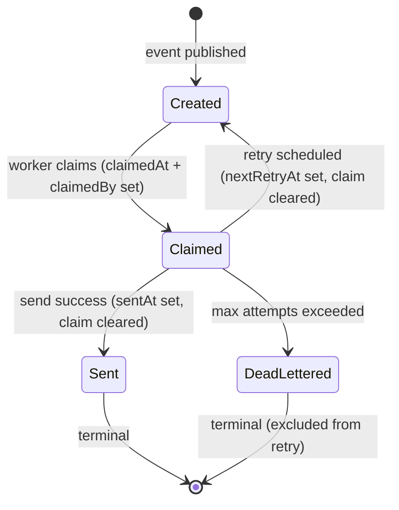

# 03. データモデル

**テーブル定義と ER 図は自動生成している → [`docs/db/README.md`](../db/README.md)**（検索つきの [DB ドキュメントサイト](https://physicalfunding.github.io/PhysiFun/) と、全体をズーム・検索できる [動く ER 図](https://physicalfunding.github.io/PhysiFun/er/) もある）

本書には、生成物からは読み取れない「領域の分け方」「整合性ルールの意図」「インデックスの狙い」「命名規則」だけを書く。

## このドキュメントの位置づけ

- **目的**: AI / 人間が「DB 設計の意図」を素早く把握するための地図
- **正本**: `packages/infrastructure/atlas/schema.sql`（Atlas の宣言的スキーマ）。テーブル・列の意味は、同じファイルの `COMMENT ON` に書く
- **生成物**: `docs/db/`（tbls で生成。PR では CI が再生成する。**手で編集しない**）と、動く ER 図（Liam ERD。main に入ると GitHub Pages に公開）。手順は `docs/guides/db-migration.md` §6
- **揮発度**: 中（領域の分け方・整合性ルール・命名の方針が変わったときに更新する。列を足すだけなら本書の更新は不要）
- **関連**:
  - `02_domain-model.md` — ドメインアグリゲートとの対応
  - `04_security-design.md` — Restrict 制約の意図、AdminAuditLog の役割
  - `05_key-flows/` — Outbox の動作シーケンス

---

## 1. 領域とテーブル

| 領域 | テーブル | 実装状況 | ER 図 |
|---|---|---|---|
| アカウントと応募 | `accounts` / `leader_applications` | ✅ | [viewpoint-account](../db/viewpoint-account.md) |
| プロジェクトと公開審査 | `projects` / `project_review_feedbacks` | ✅ | [viewpoint-project](../db/viewpoint-project.md) |
| サポート募集 | `support_recruitments` / `recruitment_schedules` / `support_tickets` | 🚧 ドメイン層・application 層まで（リーダー側の募集作成は初回リリース #212、サポーター申請は一般公開） | [viewpoint-recruitment](../db/viewpoint-recruitment.md) |
| 運営の認証と監査 | `admin_accounts` / `admin_sessions` / `admin_audit_logs` / `admin_verification_tokens` | ✅ | [viewpoint-admin](../db/viewpoint-admin.md) |
| Outbox（非同期メール送信） | `leader_application_outbox_messages` / `project_outbox_messages` | ✅ | [viewpoint-outbox](../db/viewpoint-outbox.md) |

領域の分け方は `packages/infrastructure/.tbls.yml` の `viewpoints` と揃えている。テーブルを足したら両方を更新する（どの領域にも入っていないテーブルは `tbls lint` が検出する）。

**関係性の要点:**

- `leader_applications` と `projects` の間に **直接の参照は無い**。応募内容はスナップショットとして保存し、承認時に初期 Project を作る入力として使う
- `accounts` を削除すると、所有している応募・プロジェクトも **Cascade** で削除される
- `admin_accounts` への参照はすべて **Restrict**（監査履歴を物理削除から守る。運営アカウントは論理無効化のみ）
- `admin_verification_tokens` は NextAuth の Magic Link 用トークン置き場で、FK を持たない

**サポート募集まわりの注意（インフラ層は未実装。#217 で実装するときに見直す前提）:**

- `recruitment_schedules.date` は `date` 型（JST のカレンダー日）。`startTime` / `endTime` は `"HH:MM"` 形式の文字列（JST）
- `(supportRecruitmentId, date)` に unique 制約（1 募集 × 1 日 = 1 スケジュール）

---

## 2. ドメインモデルとの対応

| テーブル | ドメイン | 備考 |
|---|---|---|
| `accounts` | `account`（値オブジェクトのみ） | ライフサイクルは application 層（`02_domain-model.md` §5） |
| `leader_applications` | `LeaderApplication` 集約 | 応募内容は `ProjectDraft`（企画）と `LeaderApplicationSnapshot`（連絡先・募集情報）に分かれて載る |
| `projects` | `Project` 集約 | |
| `project_review_feedbacks` | `Project` のサブエンティティ `ProjectReviewFeedback` | |
| `admin_accounts` | `AdminAccount` 集約 | |
| `admin_sessions` / `admin_verification_tokens` | なし | NextAuth が管理 |
| `admin_audit_logs` | なし | 運営アプリから直接書き込む |
| `support_recruitments` / `recruitment_schedules` | `SupportRecruitment` 集約（子に `RecruitmentSchedule`） | `02_domain-model.md` §8。インフラ層は未実装（#217） |
| `support_tickets` | なし | 未実装（一般公開） |
| `*_outbox_messages` | なし | infrastructure 層の Outbox |

### 列名とドメインのフィールド名が違うもの

| テーブル.列 | ドメイン |
|---|---|
| `projects.story` | `Project.body` |
| `projects.leaderIntro` | `Project.leaderIntroduction` |
| `projects.status` | `Project.publishStatus` |
| `projects.prefectureCode` + `municipality` | `Project.location`（`ProjectLocation`） |
| `leader_applications.prefectureCode` + `municipality` | `ProjectDraft.location`（`ProjectLocation`） |
| `recruitment_schedules.startTime` + `endTime` | `RecruitmentSchedule.timeRange`（`TimeRange`） |

変換は `packages/infrastructure/src/project/reconstructProject.ts`（読み込み）と `KyselyProjectCommandAdapter.ts`（書き込み）で行う。

---

## 3. 整合性ルール（削除時の挙動）

### 3.1 onDelete: Restrict（監査保護）

以下の FK は、親の**物理削除を禁止**する。監査履歴を守るため。

| 子テーブル | カラム | 親 | 意図 |
|---|---|---|---|
| `leader_applications` | `reviewedBy` | `admin_accounts` | 審査者の保全（⚠️ 下記） |
| `projects` | `reviewedBy` | `admin_accounts` | 審査者の保全（⚠️ 下記） |
| `projects` | `forcedUnpublishedBy` | `admin_accounts` | 強制非公開の実行者の保全（⚠️ 下記） |
| `project_review_feedbacks` | `reviewerId` | `admin_accounts` | 審査フィードバックの作者の保全 |
| `admin_audit_logs` | `adminAccountId` | `admin_accounts` | 操作者の保全 |
| `support_tickets` | `supporterAccountId` | `accounts` | サポーター履歴の保全 |

`admin_accounts` は事実上 **物理削除不可**（論理削除のみ）。

> ⚠️ **2026-10 時点で、`leader_applications.reviewedBy` / `projects.reviewedBy` / `projects.forcedUnpublishedBy` はどこからも書き込まれておらず、常に NULL**。
> 審査履歴の実体は `project_review_feedbacks`（公開審査）と `admin_audit_logs`（運営の全操作）に残っている。これらの列を書き込むか削除するかは別途決める。

### 3.2 onDelete: Cascade（所有関係）

| 子テーブル | カラム | 親 | 意図 |
|---|---|---|---|
| `leader_applications` | `accountId` | `accounts` | アカウント削除で応募も削除 |
| `projects` | `ownerAccountId` | `accounts` | アカウント削除でプロジェクトも削除 |
| `project_review_feedbacks` | `projectId` | `projects` | プロジェクト削除でフィードバックも削除 |
| `support_recruitments` | `projectId` | `projects` | プロジェクト削除で募集も削除 |
| `recruitment_schedules` | `supportRecruitmentId` | `support_recruitments` | 募集削除で日程も削除 |
| `support_tickets` | `recruitmentScheduleId` | `recruitment_schedules` | 日程削除でチケットも削除 |
| `admin_sessions` | `adminAccountId` | `admin_accounts` | アカウント削除でセッションも削除 |

### 3.3 onDelete: SetNull（参照だけ外す）

| 子テーブル | カラム | 親 | 意図 |
|---|---|---|---|
| `admin_audit_logs` | `adminSessionId` | `admin_sessions` | セッションが消えても監査ログは残す |

---

## 4. Unique 制約の意図

| テーブル | 制約 | 意図 |
|---|---|---|
| `accounts` | `email` | ログイン識別子の一意性 |
| `accounts` | `activationToken` | アクティベーショントークンの一意性 |
| `projects` | `slug` | 公開ページ URL（`/projects/{slug}`）の一意性。nullable（初回承認までは null。値は `id` と同じ UUID で、非公開化しても残す） |
| `recruitment_schedules` | `(supportRecruitmentId, date)` | 1 募集 × 1 日 = 1 スケジュール |
| `admin_accounts` | `email` | ログイン識別子の一意性 |
| `admin_sessions` | `sessionToken` | セッショントークンの一意性 |
| `admin_verification_tokens` | `(identifier, token)` / `token` | NextAuth の仕様 |

---

## 5. インデックス戦略の要点

### 5.1 監査ログ（複数のクエリパターン）

`admin_audit_logs` は、運営画面の絞り込みに合わせて複合インデックスを多数持つ（詳細は `04_security-design.md`）:

- `(targetType, targetId)` — 特定エンティティの全操作履歴
- `(action, createdAt)` — 「操作の種類 × 時系列」の絞り込み
- `(targetType, createdAt)` — エンティティの種類 × 期間
- `(adminAccountId, createdAt)` — 運営メンバー別の操作履歴

### 5.2 Outbox（クレーム + リトライ）

- `(sentAt, deadLetteredAt, nextRetryAt)` — 「未送信、またはリトライ対象」の絞り込み
- `(claimedBy)` — ワーカーごとに掴んでいるメッセージの追跡

### 5.3 projects の検索系

- `(category)` / `(prefectureCode)` — 公開後のフィルタ用（一般公開で本格的に使う）
- `(publishedAt)` — 新着順の並び替え用
- `(ownerAccountId)` / `(status)` — マイページ・運営ダッシュボード用

---

## 6. Outbox の状態フロー

Outbox は **アグリゲートごとに別テーブル**（`leader_application_outbox_messages` / `project_outbox_messages`）。共通の基底テーブルは作っていない（過剰な抽象化を避ける方針）。2 つのテーブルの列構成は同じ。

詳細なシーケンスは `05_key-flows/outbox-mail.md` を参照。

---

## 7. 命名規則・型方針

| 観点 | 方針 |
|---|---|
| 主キー | `id text`（UUID v4）。DB 側に DEFAULT は無く、アプリ側で生成して渡す |
| 外部キー | `<entityName>Id` という命名（例: `accountId` / `projectId`） |
| 監査の作者 FK | `<role>By` という命名（例: `reviewedBy` / `forcedUnpublishedBy`） |
| 文字列 | 長さに関係なく `text`（長さ制限はアプリ側の Zod / 値オブジェクトで行う） |
| JSON 構造体 | `jsonb`（`snsLinks` / `metadata` / `payload`） |
| 日付のみ | `date`（`recruitment_schedules.date`） |
| 列挙型 | PostgreSQL のネイティブ enum。ドメイン層と命名・値を一致させる |
| タイムスタンプ | `timestamp(3)`。`createdAt` は `DEFAULT CURRENT_TIMESTAMP`、`updatedAt`（更新される表のみ）は DEFAULT 無しでアプリ側が設定 |
| 配列カラム | PostgreSQL の配列型（enum 配列）— `roles` / `recruitmentTypes` |
| 命名 | テーブルは snake_case、カラムは camelCase（Prisma 時代の名前を引き継ぎ） |
| 説明 | テーブル・列の意味は `schema.sql` の `COMMENT ON` に書く（`docs/db/`・Supabase Studio・`types.ts` の JSDoc に反映される） |

---

## 8. 改訂履歴

| 日付 | 改訂内容 | 担当 |
|---|---|---|
| 2026-05-09 | 初稿作成（PR #201 後の状態を反映） | 設計チーム |
| 2026-10-16 | ドキュメント棚卸し：Kysely 移行の反映、フェーズ用語を「初回リリース / 一般公開」に統一、サポート募集の位置づけ（初回リリースでリーダー側を実装予定）を修正 | 設計チーム |
| 2026-10-16 | 正本を `atlas/schema.sql` に変更（#228 / #229）。命名規則・型方針を実際の SQL 型に合わせて修正 | 設計チーム |
| 2026-10-17 | 手書きの ER 図・列一覧・enum 一覧を、tbls の生成物（`docs/db/`）に置き換え（#261）。本書は設計の意図に絞った。実装とのズレ（モデル数、存在しないマイグレーション名、書き込まれていない reviewedBy 系の列）を修正 | 設計チーム |
